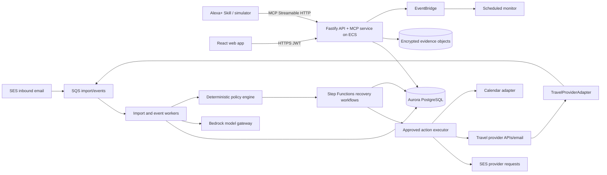

# AccessHold — Implementation Specification

**Specification version:** 1.0.0  
**Primary track:** Alexa+  
**Project status:** ready for implementation; no code is implied  
**Dependencies:** [SHARED_ENGINEERING_STANDARD.md](./SHARED_ENGINEERING_STANDARD.md), [access-contract.schema.json](./schemas/accesshold/access-contract.schema.json)  
**Validated example:** [access-contract.example.json](./examples/accesshold/access-contract.example.json)

## 1. Product contract

AccessHold watches an existing trip for changes that violate a traveler's accessibility requirements, presents inspectable evidence, and coordinates an explicitly approved recovery. It begins after booking and is not a destination-search product.

The system MUST NOT claim that a provider response, review, document, or model output guarantees physical accessibility. Its output is a time-bounded evidence and workflow state.

### 1.1 Target users

- **Traveler:** disabled adult or companion managing a trip.
- **Advocate:** trusted person granted a scoped trip role.
- **Provider operator:** airline, hotel, or transfer staff receiving a concise request.
- **Human recovery specialist:** receives exceptions with the complete evidence trail.

Children and unsupported medical travel are outside the initial release.

### 1.2 Release scope

The first release supports:

- one traveler and up to two advocates per trip;
- flights, seats, hotel rooms, and prebooked ground transfers;
- English-language confirmations and provider correspondence;
- email confirmation import and monitoring;
- one live read-only travel status/inventory adapter where credentials permit;
- provider requests through SES and a deterministic sandbox provider for action testing;
- calendar update after a confirmed change;
- Alexa+ voice plus rich-card interaction and a responsive web application.

Direct live ticket reissue is an optional provider capability. It MUST NOT be represented as available unless a real provider adapter completes it and returns an independently imported confirmation.

### 1.3 Non-goals

- Destination discovery, review aggregation, or a general travel concierge.
- Legal advice, entitlement adjudication, medical recommendations, or emergency services.
- Autonomous negotiation or purchases outside an approved policy.
- Treating reviews as verified evidence.
- Guaranteeing a room, aircraft feature, seat, or physical experience.

## 2. Requirements

### 2.1 Functional requirements

| ID | Requirement | Priority |
| --- | --- | --- |
| FR-AH-001 | Import a booking from a traveler-authorized confirmation email or manual structured entry. | P0 |
| FR-AH-002 | Extract trip/assets into a reviewable draft; no monitoring begins before traveler approval. | P0 |
| FR-AH-003 | Capture hard constraints and preferences with traveler wording, deterministic predicates, and applicable assets. | P0 |
| FR-AH-004 | Validate and persist an Access Contract using the canonical schema. | P0 |
| FR-AH-005 | Attach source-specific, timestamped evidence to exact assets; expired evidence becomes stale/unverified. | P0 |
| FR-AH-006 | Draft provider verification questions and send them only after approval. | P0 |
| FR-AH-007 | Monitor authorized email and configured provider feeds for changes, deduplicate them, and version affected assets. | P0 |
| FR-AH-008 | Re-evaluate all dependent hard constraints after every relevant change. | P0 |
| FR-AH-009 | Generate recovery options with evidence coverage, cost, terms, unknowns, and a no-action option. | P0 |
| FR-AH-010 | Require explicit, plan-bound approval before any external recovery action. | P0 |
| FR-AH-011 | Execute an approved provider request or supported provider action idempotently and record its receipt/status. | P0 |
| FR-AH-012 | Mark recovery complete only after importing a replacement confirmation and revalidating the contract. | P0 |
| FR-AH-013 | Provide Alexa+ tools and rich cards for status, evidence, changes, recovery options, approval, and handoff. | P0 |
| FR-AH-014 | Provide a human-handoff packet containing the itinerary, constraints, evidence, attempted actions, and unknowns. | P0 |
| FR-AH-015 | Support contract/trip export, correction, revocation, and deletion. | P0 |
| FR-AH-016 | Update calendar events only from confirmed itinerary versions. | P1 |

### 2.2 Integration requirements

| ID | Requirement |
| --- | --- |
| INT-AH-001 | A real Alexa+ Agent Skill or self-hosted MCP server using MCP specification 2025-11-25 or later and Streamable HTTP MUST run in the main flow. |
| INT-AH-002 | The required Alexa+ simulator or working simulated Alexa+ web experience MUST exercise the actual MCP/Skill backend in demo evidence. |
| INT-AH-003 | SES inbound/outbound email MUST be used for the live email path; Mailpit is local-only evidence. |
| INT-AH-004 | Ring, Bee, and Fire TV are not dependencies and MUST NOT be added for feature breadth. |
| INT-AH-005 | Travel providers sit behind `TravelProviderAdapter`; fixture and live results carry explicit provenance. |
| INT-AH-006 | Bedrock extraction and drafting MUST pass through the shared model gateway and output schemas. |

### 2.3 Non-functional requirements

| ID | Budget/requirement |
| --- | --- |
| NFR-AH-001 | p95 read API latency below 500 ms and p95 mutation acknowledgement below 1 s, excluding provider work. |
| NFR-AH-002 | A provider/status event begins constraint evaluation within 60 seconds of ingestion under normal load. |
| NFR-AH-003 | Alexa+ status responses return initial voice-safe content within 2.5 seconds; longer work continues with a task ID. |
| NFR-AH-004 | No duplicate provider request, calendar update, or booking action under at-least-once delivery and client retries. |
| NFR-AH-005 | A process restart loses no approved workflow state or evidence. |
| NFR-AH-006 | All hard-constraint evaluations are reproducible from contract version, evidence versions, and policy version. |

## 3. Primary user journeys and state machines

### 3.1 Watch a trip

1. Traveler authenticates and creates a trip import.
2. The importer stores encrypted raw confirmation with 30-day default retention and extracts a draft.
3. The traveler corrects assets and selects/creates access requirements.
4. The compiler maps requirements to deterministic predicates. Any unmappable requirement remains `unverified` and requires a manual predicate before activation.
5. The traveler reviews evidence status and approval policy, then activates the contract.
6. Monitoring starts only for the activated version.

### 3.2 Detect and recover from a violation

1. A change event creates a new immutable asset version; the previous version remains auditable.
2. The policy engine evaluates every hard constraint across affected and dependent assets.
3. A violation opens a `RecoveryCase`; duplicate equivalent changes attach to the existing case.
4. The option builder proposes up to three options plus `keep_original` and `human_handoff`.
5. Alexa+ announces the minimum useful summary and offers a rich card. It does not read sensitive details on an unsecured shared device without authentication.
6. Traveler approves an exact plan hash. The executor performs only listed actions.
7. A provider receipt moves the case to `awaiting_confirmation`, not `completed`.
8. Imported replacement confirmation creates a new trip version. If all hard constraints are satisfied or explicitly not applicable, the case closes; otherwise it reopens with the new evidence.

### 3.3 Contract status transitions

```text
draft -> active -> degraded -> active
                 -> violated -> recovering -> awaiting_confirmation -> active
                 -> closed
active -> closed
recovering -> human_handoff
awaiting_confirmation -> violated | human_handoff
```

`closed` is terminal. Only an advocate with `trip_admin` can close a trip. `degraded` means stale/missing evidence without a known violation; it MUST NOT be presented as safe.

### 3.4 Recovery case states

| State | Entry condition | Allowed exits |
| --- | --- | --- |
| `detected` | Hard constraint is violated | `options_ready`, `human_handoff` |
| `options_ready` | Deterministically evaluated options persisted | `awaiting_approval`, `human_handoff` |
| `awaiting_approval` | Options presented to traveler | `approved`, `rejected`, `expired`, `human_handoff` |
| `approved` | Exact plan hash and policy approved | `executing` |
| `executing` | Idempotent action runner started | `awaiting_confirmation`, `action_failed`, `human_handoff` |
| `awaiting_confirmation` | Provider acknowledged request or sandbox action returned a test confirmation | `completed`, `detected`, `human_handoff` |
| `action_failed` | Exhausted safe retries | `options_ready`, `human_handoff` |
| `completed` | Replacement confirmation imported and contract revalidated | terminal |
| `rejected`, `expired`, `human_handoff` | Explicit terminal/handoff outcome | terminal or `options_ready` for expired only |

## 4. Reference architecture



### 4.1 Component decisions

- **Web:** React + Vite SPA served through S3/CloudFront. It is not a second source of domain logic.
- **API/MCP:** one TypeScript Fastify service on ECS Fargate behind an ALB. MCP and REST share authentication, domain services, and validation.
- **Database:** Aurora PostgreSQL is the system of record. JSONB stores versioned contracts; relational tables index trips, constraints, cases, approvals, and idempotency.
- **Workflow:** Step Functions Standard owns long-running waits and retries. Domain transitions remain in the TypeScript policy package and are unit-testable without AWS.
- **Objects:** evidence/original messages in encrypted S3; database stores URI, SHA-256, retention class, and metadata.
- **Events:** SQS buffers imports/provider events; EventBridge schedules monitoring and emits domain notifications.
- **AI:** Bedrock extracts documents and drafts text only. No model can mutate contract status or call provider tools directly.

## 5. Required repository layout

```text
accesshold/
  apps/
    web/                       # React traveler/advocate UI
  services/
    api/                       # REST + MCP Streamable HTTP
    importer/                  # SES/manual confirmation import
    monitor/                   # provider polling and event normalization
    workflow/                  # Step Functions task handlers
  packages/
    domain/                    # contracts, state machines, recovery policy
    contracts/                 # JSON Schema, OpenAPI types, MCP schemas
    policy-engine/             # deterministic predicate and option evaluation
    model-gateway/             # Bedrock schemas, prompts, redaction, caching
    adapters/
      ses/
      calendar/
      travel-provider/
      reference-travel/        # explicitly labeled sandbox provider
    ui/                        # accessible shared components
    testkit/                   # deterministic clock, IDs, fixture builders
  infra/
  content/
    feature-registry/v1.json   # approved feature keys, types, units
    provider-questions/v1.json
  tests/
  docs/
  evidence/
```

## 6. Canonical domain model

The normative portable object is [access-contract.schema.json](./schemas/accesshold/access-contract.schema.json). The following tables/indexes support it; they do not replace schema validation.

### 6.1 Relational tables

| Table | Important fields and constraints |
| --- | --- |
| `travelers` | `id`, `cognito_sub` unique, `locale`, `deleted_at`; no diagnosis field |
| `traveler_constraints` | `id`, `traveler_id`, `traveler_text`, `predicate_json`, `priority`, `version`, `active`; encrypted/search-restricted |
| `trips` | `id`, `traveler_id`, `title`, `start_at`, `end_at`, `status`, `current_contract_version`, `version`, timestamps |
| `trip_members` | `trip_id`, `traveler_id`, `role` (`owner`, `advocate_view`, `advocate_admin`), unique pair |
| `contracts` | `trip_id`, `version`, `schema_version`, `document_json`, `document_sha256`, `policy_version`, `created_by`, `created_at`; composite unique |
| `assets` | `id`, `trip_id`, `contract_version`, `kind`, `provider`, `provider_reference`, `valid_from`, `valid_to`, `attributes_json`, `provenance` |
| `evidence` | `id`, `asset_id`, `source_type`, `verification_level`, `s3_uri`, `sha256`, `observed_at`, `expires_at`, `features_json`, `provenance` |
| `provider_messages` | `id`, `trip_id`, `direction`, `message_id`, `thread_id`, `received_at`, `s3_uri`, `parse_status`, unique provider/message ID |
| `change_events` | `id`, `trip_id`, `asset_id`, `external_id`, `payload_json`, `normalized_json`, `received_at`, unique adapter/external ID |
| `recovery_cases` | `id`, `trip_id`, `constraint_version`, `state`, `opened_by_event_id`, `version`, timestamps |
| `recovery_plans` | `id`, `case_id`, `option_set_version`, `plan_json`, `plan_sha256`, `expires_at`, `state` |
| `approvals` | `id`, `plan_id`, `approver_id`, `plan_sha256`, `policy_version`, `approved_at`, `authentication_context`, `expires_at` |
| `action_receipts` | `id`, `plan_id`, `action_index`, `idempotency_key`, `adapter`, `external_receipt`, `status`, `payload_json`, timestamps; unique plan/action |
| `handoff_packets` | `id`, `case_id`, `s3_uri`, `created_at`, `accessed_by` |
| `idempotency_keys`, `outbox`, `processed_events` | Shared replay/outbox behavior |

All sensitive JSON columns require application-level field minimization and database encryption. Full-text search over constraints or evidence is prohibited in v1.

### 6.2 Feature registry

`content/feature-registry/v1.json` is the only source of predicate feature definitions. Each record contains:

```json
{
  "key": "hotel.room.door_width",
  "value_type": "number",
  "allowed_units": ["cm", "in"],
  "canonical_unit": "cm",
  "allowed_sources": ["provider_written", "traveler_supplied", "official_api"],
  "stale_after_hours": 2160
}
```

Initial feature keys:

```text
flight.aircraft.accessible_lavatory       boolean
flight.seat.movable_aisle_armrest         boolean
flight.seat.width                         number (cm)
flight.mobility_device.accepted           boolean
hotel.room.roll_in_shower                 boolean
hotel.room.shower_lip_height              number (cm)
hotel.room.door_width                     number (cm)
hotel.room.bed_height                     number (cm)
hotel.room.elevator_served                boolean
hotel.room.step_free_route                boolean
transfer.vehicle.wheelchair_compatible    boolean
transfer.vehicle.ramp_or_lift             boolean
```

An unknown feature value is `null`; the predicate evaluator returns `unknown`, never false. Units normalize through tested code. Model-extracted keys outside the registry are rejected.

### 6.3 Predicate result

```text
evaluate(predicate, feature) -> satisfied | violated | unknown | not_applicable
```

Hard-constraint aggregation:

- any `violated` -> contract `violated`;
- otherwise any `unknown` -> `degraded`;
- otherwise all `satisfied`/`not_applicable` -> `active`.

Preferences are displayed separately and never silently promoted to hard constraints.

## 7. API and MCP contracts

### 7.1 REST endpoints

| Method/path | Purpose | Required role/condition |
| --- | --- | --- |
| `POST /v1/trips/imports` | Create email/manual import | owner |
| `GET /v1/trips` | List own/shared trips | trip member |
| `GET /v1/trips/{tripId}` | Trip and current summary | trip member |
| `PATCH /v1/trips/{tripId}/draft` | Correct draft assets | admin + expected version |
| `PUT /v1/trips/{tripId}/contract` | Validate/activate new contract version | admin + approval |
| `POST /v1/trips/{tripId}/evidence-requests` | Draft provider request | admin |
| `POST /v1/evidence-requests/{id}/approve` | Send exact approved request | admin + plan hash |
| `GET /v1/trips/{tripId}/evidence` | Evidence with status/timestamps | trip member |
| `GET /v1/trips/{tripId}/changes` | Normalized change history | trip member |
| `GET /v1/cases/{caseId}/options` | Evaluated recovery options | trip member |
| `POST /v1/plans/{planId}/approvals` | Bind approval to exact plan hash | admin |
| `POST /v1/plans/{planId}/execute` | Execute approved unexpired plan | admin + idempotency |
| `POST /v1/cases/{caseId}/handoff` | Generate human-handoff packet | trip member |
| `GET /v1/trips/{tripId}/export` | Export portable data | owner/admin |
| `DELETE /v1/trips/{tripId}` | Start deletion workflow | owner |
| `GET /v1/tasks/{taskId}` | Async operation status | task owner |

All list responses redact provider references and exact access text when the caller has view-only scope and the owner has enabled private mode.

### 7.2 MCP tools

Tool names are stable. Inputs/outputs MUST have JSON Schemas in `packages/contracts/mcp/`.

| Tool | Input | Success output | Side effect |
| --- | --- | --- | --- |
| `watch_trip` | `trip_import_id`, `confirmed_contract_version` | `trip_id`, `status`, `unknown_count` | Activates monitoring after explicit confirmation |
| `get_trip_status` | `trip_id` | status, changed assets, hard-constraint counts, `as_of` | none |
| `get_evidence` | `trip_id`, `constraint_id` | evidence level, source type, observed/expiry times, safe excerpt URI | none |
| `list_recovery_options` | `case_id` | option cards and `option_set_version` | none |
| `select_recovery_option` | `case_id`, `option_id`, `expected_version` | `plan_id`, `plan_sha256`, expiry | Creates immutable pending plan only |
| `approve_recovery` | `plan_id`, `plan_sha256`, `approval_phrase` | `approval_id`, `execution_task_id` | Executes only if policy permits voice; otherwise returns `web_approval_required` |
| `request_human_handoff` | `case_id`, `callback_preference` | handoff ID/status | Creates packet and task |
| `stop_monitoring` | `trip_id`, `expected_version` | stopped status | Stops future collection; does not delete data |

MCP Apps/rich cards use `ui://accesshold/trip/{tripId}`, `ui://accesshold/case/{caseId}`, and `ui://accesshold/evidence/{evidenceId}`. Every card uses the same REST authorization checks and a short-lived viewer token. No raw evidence is embedded in tool text.

### 7.3 Approval rules

- Plan hash covers option, current asset versions, action list, price/tax/currency, terms, evidence versions, and expiry.
- Any material change invalidates the hash and approval.
- Voice approval is allowed only for `send_provider_request` and `calendar_update` by default.
- `sandbox_rebook` may be voice-approved in a clearly labeled test trip.
- `live_rebook` requires rich-card/web approval with recent authentication and is disabled until a real adapter is certified.
- Approval expires after 10 minutes or when inventory/price/version changes, whichever is first.

## 8. Travel-provider adapter and truthful execution

```typescript
interface TravelProviderAdapter {
  capabilities(): {
    readStatus: boolean;
    readInventory: boolean;
    requestChangeByEmail: boolean;
    rebook: boolean;
    live: boolean;
  };
  fetchTrip(ref: ProviderReference): Promise<ProviderTripSnapshot>;
  fetchChanges(ref: ProviderReference, cursor?: string): Promise<ProviderChangePage>;
  searchRecovery(input: RecoverySearch): Promise<ProviderOption[]>;
  requestChange(input: ApprovedChangeRequest): Promise<ActionReceipt>;
  rebook?(input: ApprovedRebookRequest): Promise<ActionReceipt>;
  importConfirmation(ref: ActionReceipt): Promise<ProviderTripSnapshot | Pending>;
}
```

### Required adapters

1. **ReferenceTravelAdapter:** deterministic, fixture-backed, supports status, inventory, change events, and `sandbox_rebook`. It MUST display `TEST PROVIDER` in UI and receipts. It is used for repeatable E2E tests and the external-disruption portion of the hackathon demo.
2. **SesProviderAdapter:** sends approved change/verification requests and parses authorized replies. It does not claim rebooking.
3. **One live read-only adapter:** selected during preflight from currently documented travel status/inventory APIs available to the implementation account. The agent MUST record its official documentation and implemented capabilities. If no credentials are available, this release gate remains blocked and no fabricated live badge is allowed.

### Recovery truth table

| Last observed result | User-facing state |
| --- | --- |
| Request drafted | `not_sent` |
| SES accepted message | `request_sent`; not provider-approved |
| Provider reply received but unparsed | `confirmation_review_required` |
| Sandbox rebook receipt | `test_change_recorded`; not live travel |
| Live provider receipt without imported itinerary | `awaiting_confirmation` |
| New confirmation imported, constraints revalidated | `completed` or `violated` based on evidence |

## 9. AI operations

### 9.1 `booking_extract.v1`

Input: redacted MIME text/HTML plus allowlisted attachments. Output: assets, dates/time zones, provider references, confidence per field, and source spans. It cannot activate a trip.

Validation:

- dates parse and occur in a logical order;
- airport/provider identifiers use registry formats;
- every extracted field has a source span;
- ambiguous airports/rooms become review tasks;
- traveler must confirm the draft.

### 9.2 `provider_reply_extract.v1`

Output: `asset_reference_candidates`, registry features, values/units, exact evidence spans, response timestamp, uncertainty, and whether the provider explicitly declined to answer. It cannot raise `verification_level` above the source's allowed level.

### 9.3 `provider_request_draft.v1`

Input: approved constraints and missing features. Output: a concise message with no diagnosis or unnecessary profile details. A deterministic template is the fallback and is preferred when it covers the request.

### 9.4 `recovery_explanation.v1`

Input: deterministic option comparison. Output: a 70-word maximum explanation and a 25-word voice summary. Numbers, times, costs, and evidence statuses must match input exactly; a validator rejects mismatches.

## 10. UX specification

### 10.1 Web screens

1. **Trip list:** current status, next departure, open case count, stale-data timestamp.
2. **Import review:** side-by-side source excerpt and extracted assets; correction controls.
3. **Access Contract editor:** traveler wording, predicate explanation, applicable assets, hard/preference, evidence status.
4. **Trip timeline:** asset versions and evidence changes; no infinite-scroll-only history.
5. **Recovery case:** what changed, evidence, options, unknowns, no-action and human-handoff choices.
6. **Approval:** exact action, cost/terms, expiry, and plan hash version in understandable language.
7. **Evidence detail:** source type, timestamp, scope, redacted document, why it does/does not verify.
8. **Privacy and members:** roles, retention, export/delete, connected providers, consent revocation.

### 10.2 Voice/rich-card behavior

- First response answers the user's question in at most three short sentences.
- A violation announcement names the changed asset and consequence, not a diagnosis.
- Rich cards carry comparisons, exact numbers, evidence, and approval.
- Unknowns are read explicitly when material.
- Shared-device mode hides sensitive constraints until the configured authentication check.

All flows require screen-reader labels, keyboard operation, 200% text zoom, non-color status indicators, and reduced motion.

## 11. Security, privacy, and safety

| ID | Requirement |
| --- | --- |
| SEC-AH-001 | Access needs are sensitive data; no advertising, public profile, or model-training use by default. |
| SEC-AH-002 | Raw confirmation/email retention defaults to 30 days; derived contracts persist until trip deletion or 30 days after trip end, then are deleted unless the traveler extends retention. |
| SEC-AH-003 | Evidence downloads use short-lived signed URLs after object-level authorization. |
| SEC-AH-004 | Provider message HTML is sanitized and never rendered as active content; attachments are type/size scanned. |
| SEC-AH-005 | No provider action without plan-bound approval, idempotency, and an audit record. |
| SEC-AH-006 | Advocates have revocable least-privilege roles; revocation invalidates sessions and signed links. |
| SEC-AH-007 | Delete raw media, derived evidence, exports, MCP viewer tokens, and cached prompts under the deletion workflow. |
| SEC-AH-008 | Rights disputes, emergencies, medical needs, and ambiguous provider responses route to a human without automated assertions. |

Abuse tests MUST cover malicious confirmation HTML, prompt injection in provider replies, forged change events, reused approval hashes, stale inventory, cross-traveler evidence access, and email replay.

## 12. Observability and analytics

Metrics:

- import extraction correction rate by field;
- active contracts and evidence staleness;
- change ingestion-to-evaluation latency;
- violations by source and asset kind;
- false-verification incidents (target zero);
- options generated/presented/approved/executed/confirmed;
- recovery action duplicate-prevention count;
- human-handoff rate and reason;
- model schema-repair/fallback rate and cost per active trip.

Logs contain trip/contract/case IDs, not constraint text, raw confirmation, provider message body, or traveler profile. A redaction test MUST inspect emitted logs.

## 13. Test and acceptance matrix

### 13.1 P0 acceptance scenarios

| ID | Scenario and expected result |
| --- | --- |
| AC-AH-001 | Given an unreviewed import, when monitoring starts prematurely, then activation is rejected. |
| AC-AH-002 | Given ambiguous dates/time zones, when extraction completes, then the fields require correction rather than guessing. |
| AC-AH-003 | Given a valid contract, when serialized, then it passes the canonical schema and round-trips without semantic changes. |
| AC-AH-004 | Given a numeric requirement and different units, when evaluated, then normalization produces the expected result. |
| AC-AH-005 | Given missing evidence, when a feature is evaluated, then status is unknown/degraded, not satisfied. |
| AC-AH-006 | Given a review claiming a feature, when ingested, then it cannot become provider-confirmed evidence. |
| AC-AH-007 | Given expired evidence, when its expiry passes, then dependent contracts become degraded. |
| AC-AH-008 | Given duplicate provider events, when consumed twice, then one asset version/case results. |
| AC-AH-009 | Given an aircraft swap removing a hard feature, when evaluated, then a case opens and dependent transfer options are re-evaluated. |
| AC-AH-010 | Given an aircraft change retaining all hard features, when evaluated, then no false violation is opened. |
| AC-AH-011 | Given a changed price or inventory after options display, when approval arrives, then it is rejected as stale. |
| AC-AH-012 | Given approval for plan A, when submitted for plan B, then execution is denied. |
| AC-AH-013 | Given a repeated execution request, when retried, then only one external action/receipt exists. |
| AC-AH-014 | Given SES request acceptance, when checking status, then the case is awaiting confirmation, not completed. |
| AC-AH-015 | Given a replacement confirmation with an unresolved hard constraint, when imported, then the case reopens. |
| AC-AH-016 | Given a valid replacement confirmation, when revalidated, then calendar update and completion occur once. |
| AC-AH-017 | Given a view-only advocate, when requesting evidence outside scope, then access is denied and audited. |
| AC-AH-018 | Given prompt injection in a provider email, when extracted, then no tool/action instruction is executed. |
| AC-AH-019 | Given revoked monitoring consent, when the next poll occurs, then no provider request is made. |
| AC-AH-020 | Given a real Alexa+ session, when status/options/handoff are invoked, then the actual backend and rich-card authorization path work. |

### 13.2 Fixture suite

Provide at least 100 versioned fixtures covering: four asset kinds; every predicate operator; unit conversion; null/stale/conflicting evidence; duplicate/out-of-order changes; schedule dependency failures; three recovery outcomes; and malicious provider text. A snapshot of each deterministic evaluation includes policy version and explanation codes.

### 13.3 Performance and resilience tests

- 10,000 trips with 50 assets/evidence records each; trip reads remain within budget.
- 500 change events/minute for 15 minutes without loss or duplicate actions.
- Bedrock timeout, malformed JSON, provider 429/500, SES retry, workflow restart, and database failover tests.
- Approval and idempotency race tests with 20 concurrent identical requests.

## 14. Infrastructure and deployment

CDK MUST create or configure:

- VPC with private compute/data subnets and controlled egress;
- ALB + ECS Fargate API/MCP and worker services;
- Aurora PostgreSQL, S3 evidence/import buckets, SQS queues/DLQs, EventBridge schedules;
- Step Functions workflows and task IAM;
- Cognito user pool/app clients and SES identities/rules;
- Secrets Manager, KMS, CloudWatch dashboards/alarms, budget alerts;
- CloudFront + S3 web distribution with security headers.

Deployment order: foundation → data → compute → workflow → web/observability. Database migrations run as a gated deployment task with rollback/restore documentation. No production data is seeded.

## 15. Implementation slices

### Slice 0 — walking skeleton

- Repository, CI/CD, auth, base web/API, canonical schema validation.
- Real Alexa+ MCP handshake through the actual backend.
- One deterministic `get_trip_status` fixture trip labeled as such.

**Gate:** real Alexa+ session invokes deployed/local-tunneled backend; no domain breadth yet.

### Slice 1 — import and Access Contract

- SES/manual import, review UI, feature registry, predicate editor, schema persistence.
- Deterministic evaluation and unit fixtures.

**Gate:** AC-AH-001 through AC-AH-007.

### Slice 2 — monitoring and violation

- Reference provider plus live read-only adapter when available, change versioning, scheduled monitor, case timeline.
- Alexa+ status/evidence cards.

**Gate:** AC-AH-008 through AC-AH-010 and AC-AH-020 for status/evidence.

### Slice 3 — recovery and confirmation

- Option builder, plan hashing, rich approval, SES/reference execution, confirmation import, handoff, calendar.

**Gate:** AC-AH-011 through AC-AH-016 and full disruption demo.

### Slice 4 — release hardening

- Retention/deletion, member roles, performance, accessibility, security, evaluation, runbook, product feedback.

**Gate:** all P0 scenarios, clean-checkout reproduction, device evidence, rubric at least 90.

## 16. Demo and validation evidence

The under-three-minute demo MUST show:

1. real Alexa+ interaction with an actual imported test trip;
2. Access Contract with one explicit unknown;
3. an approved provider evidence request;
4. a labeled ReferenceTravel aircraft-swap event and deterministic violation;
5. recovery comparison and plan-bound approval;
6. sandbox execution explicitly labeled as test travel;
7. replacement test confirmation imported and revalidated;
8. one unknown or failure routed to human handoff.

The voiceover MUST NOT call a sandbox ticket a real booking or provider evidence a guarantee.

Validation requires compensated review by disabled travelers/advocates. Report correction rates, false-verification rate, evaluation latency, action idempotency, unresolved-constraint action count, and usability findings. User-research claims require actual notes/consent, not generated personas.

## Optional mini-challenge artifacts

These are optional and MUST NOT weaken the primary Alexa+ loop.

- **AWS Builder:** submit the actual Step Functions monitoring/recovery workflows, Bedrock evidence extraction, event-driven provider adapters, and measured reliability/cost evidence. A list of AWS services without running traces is insufficient.
- **Open Source:** publish a separate `access-contract-tools` project containing the versioned schema, deterministic reference validator, feature-registry tooling, and synthetic disruption fixtures. Include its own license, README, tests, and contribution/setup instructions. Licensing the main app alone does not qualify.

Update `docs/product-feedback.md` and the friction log for both the primary and optional implementations.

## 17. Completion rubric and release blockers

Use the shared 100-point rubric with this domain evidence:

| Category | AccessHold full-credit evidence |
| --- | --- |
| Functional — 25 | All 16 functional requirements; complete import→monitor→recover→reconfirm loop |
| Platform — 15 | Real Alexa+ MCP/Skill, rich cards, authenticated tools, demonstrated status/options/handoff |
| Architecture/reliability — 15 | Reproducible policy evaluation, immutable versions, durable workflows, zero duplicate actions in race tests |
| Security/privacy — 15 | Sensitive-data inventory, role tests, safe email/model ingestion, real export/delete/revocation |
| UX/accessibility — 10 | Contract/evidence clarity, screen-reader and keyboard approval, shared-device privacy |
| Testing/evaluation — 10 | 100+ fixtures, all 20 P0 scenarios, live adapter evidence or disclosed blocked gate, traveler/advocate review |
| Docs/operations — 5 | Setup, adapter runbook, restore/replay, model/provider incident procedures, complete traceability |
| Demo/submission — 5 | Legible under-three-minute real Alexa+ demo with truthful sandbox labeling and product feedback |

### Non-negotiable completion gates

- No action executes with an unresolved hard constraint outside the explicitly approved action scope.
- No unknown evidence is displayed as verified.
- No recovery is complete before replacement confirmation and revalidation.
- No live provider capability is claimed from ReferenceTravel or SES acceptance alone.
- No critical authorization, approval-replay, or sensitive-data leakage issue remains.
