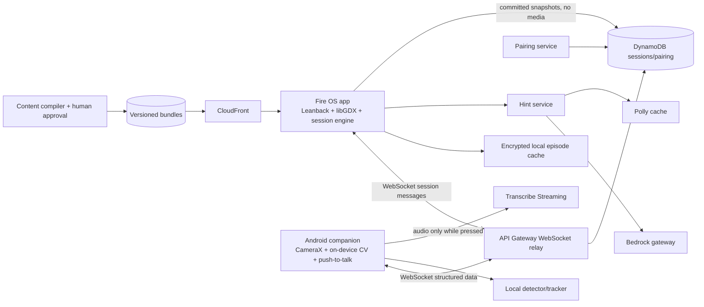

# CurioLab — Implementation Specification

**Specification version:** 1.0.0  
**Primary track:** Fire TV  
**Project status:** ready for implementation; no code is implied  
**Dependencies:** [SHARED_ENGINEERING_STANDARD.md](./SHARED_ENGINEERING_STANDARD.md), [episode.schema.json](./schemas/curiolab/episode.schema.json)  
**Validated draft example:** [episode.example.json](./examples/curiolab/episode.example.json)

## 1. Product contract

CurioLab is a Fire OS science episode in which a child performs a real household experiment and the confirmed measurement changes the episode's scene parameters and narrative branch. It is not an open-ended AI experiment generator.

The first release contains one polished 10–12 minute episode, **The Bridge to Moon Base**, for one or two children ages 7–11 with an adult. It supports Fire TV remote navigation, an Android companion camera, manual measurement fallback, captions, reduced motion, and push-to-talk voice through the companion app.

### 1.1 Learning objective

Given two paper structures and one changed variable, the child will:

1. make an explicit prediction;
2. conduct a controlled comparison using the same support spacing and identical coins;
3. describe whether the result matched the prediction;
4. explain that folding changes the paper's shape and can change its load-bearing behavior, without deriving a universal rule from one trial.

The episode MUST distinguish one observation from a general scientific law and prompt a repeat/variable change.

### 1.2 Release scope

- One Fire OS reference application, minimum SDK 28, landscape 1080p.
- One Android companion application for camera and optional voice.
- One safe paper-bridge experiment using a printable calibration mat.
- Two measured trials: `flat_load` and `folded_load`.
- Authored branches for greater/equal/lower comparison and all prediction outcomes.
- Offline episode playback and manual completion after the content bundle is downloaded.
- Online pairing, companion observations, live constrained hints, and anonymous session analytics.

### 1.3 Non-goals

- A curriculum catalog, accounts for children, public sharing, or social feeds.
- Arbitrary camera understanding of any experiment or object.
- Automatic scientific conclusions from an image.
- Continuous microphone/camera streaming to AWS.
- Live generation of episode graphs, materials, safety instructions, or scientific facts.
- Claiming learning improvement without the specified study.

## 2. Requirements

### 2.1 Functional requirements

| ID | Requirement | Priority |
| --- | --- | --- |
| FR-CL-001 | Download, verify, cache, and launch a signed/versioned episode bundle on Fire OS. | P0 |
| FR-CL-002 | Present adult consent, safety, privacy, accessibility, and camera choices before the first lab. | P0 |
| FR-CL-003 | Pair one companion to a TV session using a short-lived code and scoped credentials. | P0 |
| FR-CL-004 | Record a prediction before displaying the corresponding experimental result. | P0 |
| FR-CL-005 | Guide the exact paper-bridge protocol and verify calibration before camera-assisted counting. | P0 |
| FR-CL-006 | Produce a stable observed coin count with confidence and occlusion/error states on the companion. | P0 |
| FR-CL-007 | Freeze the count on the adult's collapse action and require family confirmation or correction before use. | P0 |
| FR-CL-008 | Allow complete manual-remote measurement and non-camera completion. | P0 |
| FR-CL-009 | Evaluate graph branches deterministically from confirmed predictions and measurements. | P0 |
| FR-CL-010 | Render scenes with actual measured parameters; do not substitute a canned success value. | P0 |
| FR-CL-011 | Support a second trial and greater/equal/lower comparison with a variable-change prompt. | P0 |
| FR-CL-012 | Provide authored hint fallback and optional schema-bounded Bedrock hints. | P0 |
| FR-CL-013 | Resume an interrupted session at the last committed node without duplicating measurements. | P0 |
| FR-CL-014 | Provide captions, scalable UI, reduced motion, remote-only use, and optional push-to-talk prediction input. | P0 |
| FR-CL-015 | Delete session artifacts on request and automatically under retention policy. | P0 |
| FR-CL-016 | Publish only schema-valid, graph-valid, asset-verified, human-approved content. | P0 |

### 2.2 Integration requirements

| ID | Requirement |
| --- | --- |
| INT-CL-001 | The main episode MUST run in an installable Fire OS application and be demonstrated on an actual Fire TV device or the permitted Fire TV simulator. |
| INT-CL-002 | The companion MUST use CameraX and on-device perception; raw experiment video MUST NOT be uploaded. |
| INT-CL-003 | Confirmed observations and session messages use the deployed API Gateway WebSocket relay; no direct browser-to-AWS credentials. |
| INT-CL-004 | Bedrock hints use the shared gateway; authored fallback hints work with Bedrock disabled. |
| INT-CL-005 | Optional voice uses push-to-talk companion audio and Amazon Transcribe Streaming; no continuous listening. |
| INT-CL-006 | Polly-generated character/hint audio is cached by content hash; preauthored dialogue ships in the episode bundle. |

### 2.3 Non-functional requirements

| ID | Budget/requirement |
| --- | --- |
| NFR-CL-001 | At 1080p, scene animation sustains 30 fps on the reference Fire TV device; remote response begins within 100 ms. |
| NFR-CL-002 | p95 stable-observation-to-scene latency below 700 ms online, measured on reference hardware and a 50 ms RTT network. |
| NFR-CL-003 | Scene branch computation below 16 ms and never waits on a model call. |
| NFR-CL-004 | A network/Bedrock outage does not block remote-only episode completion. |
| NFR-CL-005 | Camera-assisted count is within ±1 coin of confirmed ground truth in at least 95% of valid controlled-protocol test runs; invalid setups must request recalibration. |
| NFR-CL-006 | No raw frame, raw audio, or child name is written to application logs or cloud analytics. |

## 3. Experiment protocol and measurement truth

### 3.1 Required physical setup

The content bundle includes a printable A4/Letter `LabMat` with four ArUco markers, two support positions exactly 150 mm apart, a central load zone, and a camera-placement guide.

Materials:

- two identical books/supports of the same height;
- two sheets of identical paper;
- up to 30 identical coins chosen by the adult;
- the printed mat and a stable phone stand;
- scissors are not required; folding is done by hand.

The adult confirms small-object supervision. The app prohibits throwing, placing objects in the mouth, standing on furniture, and using glass/heavy objects. The experiment is performed on a stable low table.

### 3.2 Trial procedure

1. Adult selects coin type and performs camera calibration.
2. Flat paper is placed across the supports; the app verifies an empty load zone.
3. Child adds one coin at a time after the previous coin is stable for 500 ms.
4. The companion displays count, stability, and occlusion. It does not announce success/failure.
5. When the bridge collapses or the adult decides to stop, the adult taps **Mark stop**.
6. The last stable count is frozen and displayed on TV. The family confirms or corrects it.
7. The confirmed count becomes `measurements.flat_load`.
8. The folded trial repeats the same supports, spacing, paper type, and coin type; only paper shape changes.
9. Confirmed `measurements.folded_load` drives comparison and reflection.

The measured variable is **confirmed count at adult-marked stop**, not an assertion of exact material failure force. No automatic collapse detection is claimed in v1.

### 3.3 Companion perception pipeline

1. CameraX delivers 1280×720 frames at a target 15 fps to an in-memory analyzer.
2. OpenCV ArUco detects the four mat markers and computes a homography. Calibration fails if any marker is missing, reprojection error exceeds 8 pixels, or the load zone is occluded for over one second.
3. A custom single-class TFLite object detector exported for MediaPipe Tasks detects coins in the rectified load-zone ROI.
4. Non-maximum suppression and a centroid tracker associate detections across frames.
5. A candidate is added to the stable set only when its center remains within 12 rectified pixels for 500 ms and detector confidence is at least 0.65.
6. Overlap, sudden count decrease, motion blur, or tracker loss sets `needs_review`; the app never silently compensates by guessing.
7. Only structured observations leave the device. Frame buffers are reused and never persisted by application code.

The model training dataset must include at least 50 recording sessions, 10 supported lighting/background combinations, partial overlap, hands entering/leaving, empty zones, and the supported coin types. Negative images include round non-coin objects. Training data requires documented consent and no child identifiers.

## 4. Episode graph and deterministic behavior

The canonical graph contract is [episode.schema.json](./schemas/curiolab/episode.schema.json).

### 4.1 Runtime variables

```text
predictions.flat_winner       = flat | folded | same | unsure
predictions.folded_change     = more | fewer | same | unsure
measurements.flat_load        = integer 0..100
measurements.folded_load      = integer 0..100
session.camera_mode           = companion_cv | manual_remote
session.accessibility_mode    = standard | reduced_motion | no_timing
```

Only graph nodes and the session engine can write variables. Model output cannot write them.

### 4.2 Required episode sequence

```text
welcome
  -> safety_and_consent
  -> problem_scene
  -> flat_prediction
  -> flat_lab
  -> flat_result_scene(measured flat_load)
  -> folded_prediction
  -> folded_lab
  -> comparison_branch
       folded_load > flat_load -> greater_scene
       folded_load = flat_load -> equal_scene
       folded_load < flat_load -> lower_scene
  -> variable_change_prompt
  -> reflection_assessment
  -> measured_summary
```

`flat_result_scene` receives `load_count=flat_load`; its animation displays that many supply crates up to a documented visual cap, with the exact number always in text. The visual cap MUST NOT change the spoken or stored measurement.

### 4.3 Graph validation

Publishing MUST reject:

- duplicate IDs, missing next nodes, unreachable nodes, or cycles without an explicit bounded loop;
- a branch without a default or with non-exhaustive comparison coverage;
- a measurement outside declared bounds or without manual fallback;
- an unapproved safety/science review;
- missing asset hashes, captions, or learning-objective assessment nodes;
- live hints enabled without a fallback set and valid prompt/schema version;
- scene parameters not declared by the renderer's parameter registry.

The graph compiler produces an immutable runtime bundle and a graph SHA-256. Runtime refuses a bundle whose hash/signature differs from the manifest.

## 5. Reference architecture



### 5.1 Authority and failure behavior

- The **Fire TV session engine is authoritative** for graph state, predictions, confirmed measurements, and scene transitions.
- The companion is an untrusted observation/voice client. It cannot select a branch or write a confirmed measurement directly.
- The backend relays, authenticates, stores committed snapshots, and serves content/hints. It is not required for local branch computation.
- If relay is unavailable, TV offers manual mode. A paired session cannot be migrated to another TV without a new adult confirmation.
- A reconnect includes last acknowledged `state_sequence`; duplicate observations and confirmations are ignored.

## 6. Required repository layout

```text
curiolab/
  apps/
    firetv/                      # Kotlin Fire OS app
      src/main/java/.../ui/      # Leanback activities/views
      src/main/java/.../scene/   # libGDX renderer and choreography
      src/main/java/.../session/ # authoritative session coordinator
    companion/                   # Kotlin Android app
      src/main/java/.../camera/
      src/main/java/.../voice/
  services/
    pairing/                     # REST pairing/token exchange
    session-relay/               # API Gateway WebSocket handlers
    content/                     # signed bundle manifest service
    hints/                       # Bedrock/Transcribe/Polly orchestration
  packages/
    episode-engine/              # pure Kotlin graph runtime and validators
    session-contracts/           # Kotlin + TypeScript generated message types
    scene-parameters/            # renderer registry and exact value mapping
    content-compiler/            # TypeScript publisher and graph validation
    perception/                  # Android detector/tracker/calibration module
    model-gateway/
    testkit/
  content/
    episodes/bridge-to-moon-base/
      episode.json
      dialogue.json
      hints.json
      scenes.json
      assets/
      lab-mat.pdf
      reviews.json
    datasets/README.md           # consented dataset manifest; no private media in Git
  infra/
  tests/
  docs/
  evidence/
```

## 7. Session and API contracts

### 7.1 REST pairing/content endpoints

| Method/path | Behavior |
| --- | --- |
| `POST /v1/sessions` | TV creates anonymous parent-approved session and one-time six-character pairing code; expiry 5 minutes |
| `POST /v1/pairings/exchange` | Companion exchanges code + device nonce for scoped session credential; one successful use only |
| `DELETE /v1/sessions/{id}/pairing` | Adult revokes companion and invalidates tokens |
| `GET /v1/sessions/{id}` | Returns current committed snapshot to authorized devices |
| `DELETE /v1/sessions/{id}` | Starts deletion of snapshots, transcripts, and analytics identifiers |
| `GET /v1/episodes/{id}/manifest` | Returns signed manifest, version, hashes, and CDN URLs |
| `POST /v1/hints` | Returns validated hint for current node/attempt count; authored fallback on failure |

Pairing codes exclude ambiguous characters, have at least 20 bits of entropy, are rate-limited by device/IP, and are not the session credential.

### 7.2 WebSocket messages

Every message includes `schema_version`, `message_id`, `session_id`, `device_id`, `sequence`, `sent_at`, and `type`.

| Type | Sender | Important payload | Receiver action |
| --- | --- | --- | --- |
| `session.hello` | either | credential, last acknowledged sequence | returns snapshot/resume offset |
| `observation.candidate` | companion | `trial`, `observed_count`, `confidence`, `calibration`, `frame_sequence` | TV displays transient state only |
| `observation.stopped` | companion | `trial`, `last_stable_count`, `confidence`, `stop_reason` | TV enters measurement confirmation |
| `measurement.confirm` | TV or companion with TV approval | `trial`, `confirmed_count`, `expected_state_sequence` | TV commits exactly once |
| `prediction.commit` | TV | `variable`, `option`, `expected_state_sequence` | TV commits prediction |
| `voice.transcript` | companion | `transcript`, `confidence`, `push_to_talk_session` | TV maps only to current allowed options |
| `state.snapshot` | TV | committed graph state, version, sequence | relay persists; companion updates display |
| `scene.command` | TV | scene ID, parameters, transition ID | local renderer; relay may record metadata |
| `hint.request` | TV | node, attempt count, measurement/prediction context | hint service returns bounded text/audio |
| `session.error` | either | typed code, recoverable flag | display recovery; no silent reset |

Messages are limited to 16 KB; media is rejected. Sequence numbers are monotonic per sender. All committed messages are idempotent by `message_id`.

## 8. Fire TV application design

### 8.1 Modules

- **Leanback UI:** home, consent, pairing, lab instructions, confirmation, settings, privacy.
- **Episode engine:** pure Kotlin, no Android/AWS imports; deterministic graph transitions and state snapshots.
- **Scene renderer:** libGDX with a versioned `SceneParameterRegistry`; loads only authored scene IDs.
- **Content store:** encrypted private app storage, manifest/hash verification, LRU cache with two-version rollback.
- **Relay client:** reconnect, sequence acknowledgement, token refresh, offline transition.
- **Accessibility:** caption rendering, focus traversal, reduced motion, no-timing mode, content description for every actionable view.

### 8.2 Screens and states

1. **Welcome:** Continue, New episode, Accessibility, Privacy.
2. **Adult gate:** safety/consent; no dark patterns.
3. **Pairing:** QR plus six-character code, status, manual-mode choice.
4. **Story:** scene + captions + large remote focus targets.
5. **Prediction:** 2–4 large options; no correct answer revealed.
6. **Lab:** illustrated steps, camera status, adult stop, manual option always visible.
7. **Measurement confirmation:** exact number, observed confidence, minus/plus correction, confirm.
8. **Comparison:** two actual values and greater/equal/lower explanation.
9. **Reflection:** prediction revisited without shaming; “one trial suggests” language.
10. **Summary:** measured values, learning objective, replay variable-change option.

Every screen supports back navigation without losing committed state and explicit loading/offline/error states.

## 9. AI/voice operations

### 9.1 Hint generation

`hint_generate.v1` receives only:

```json
{
  "node_id": "node_flat_lab",
  "attempt_count": 2,
  "prediction": "folded",
  "flat_load": 4,
  "camera_mode": "companion_cv",
  "last_error": "occluded"
}
```

Output:

```json
{
  "hint_id": "01J...",
  "text": "Check that all four corner markers are visible, then try one coin again.",
  "hint_level": 2,
  "uses_fallback": false
}
```

Validation requires 5–45 words, no new materials/actions, no diagnosis/emotion/intelligence inference, and inclusion of an approved recovery for the current error. Failure returns the authored hint at the same level. Hints never reveal the comparison result before measurement.

### 9.2 Voice prediction

- Audio exists only while the companion button is held and has a visible recording indicator.
- Transcribe Streaming returns a transcript; a deterministic option mapper accepts exact/synonym phrases from the current prediction node.
- Ambiguous/low-confidence speech leaves the selection unchanged and offers remote choices.
- Audio buffers and transcripts are deleted after mapping; only the selected option and latency are stored.

### 9.3 Character dialogue

Preauthored dialogue and captions are the default. Polly may synthesize approved hint text. No voice cloning, child voice retention, or generated character voice is used.

## 10. Security, privacy, and child safety

| ID | Requirement |
| --- | --- |
| SEC-CL-001 | No child account, name, precise location, advertising ID, or behavioral advertising profile. |
| SEC-CL-002 | Raw frames remain in companion memory; cloud message tests reject image/audio fields. |
| SEC-CL-003 | Voice requires push-to-talk and visible state; no wake-word or background microphone service. |
| SEC-CL-004 | Pairing tokens are scoped to one session/device and revoked on completion, adult action, or 12-hour expiry. |
| SEC-CL-005 | Anonymous session snapshots delete after 7 days; deletion request covers snapshots, hints, and transient voice records. |
| SEC-CL-006 | Content bundles are signed and hash-verified; unapproved content cannot execute. |
| SEC-CL-007 | Live model text is sanitized, length-bounded, and never rendered as HTML or spoken without schema validation. |
| SEC-CL-008 | Adult consent is required for analytics separately from episode use; core play works with analytics off. |

Threat tests include pairing-code brute force, session token replay, malicious episode bundle, oversized WebSocket messages, prompt injection via transcript, forged companion observations, and cloud media exfiltration attempts.

## 11. Observability and evaluation

Safe metrics:

- episode start/completion and current node;
- pairing success/latency/failure code;
- camera calibration failure reason;
- observed-vs-confirmed count absolute difference;
- observation-to-scene latency;
- manual fallback usage;
- hint level/fallback rate;
- graph/schema/content validation failure;
- frame rate, crash/ANR, reconnect count;
- learning assessment responses as coarse correctness, never child identity.

No analytics event contains free-form child speech, names, images, or exact household details.

## 12. Test and acceptance matrix

### 12.1 P0 acceptance scenarios

| ID | Scenario and expected result |
| --- | --- |
| AC-CL-001 | Given an unsigned/modified bundle, when launching, then content is rejected and prior signed version remains usable. |
| AC-CL-002 | Given an expired pairing code, when exchanged, then pairing fails without creating credentials. |
| AC-CL-003 | Given a second companion using an already consumed code, when pairing, then it is denied. |
| AC-CL-004 | Given no prediction, when the lab result is requested, then the engine remains at prediction. |
| AC-CL-005 | Given missing/misaligned mat markers, when counting, then calibration blocks stable observations. |
| AC-CL-006 | Given a stationary valid coin for less than 500 ms, when frames arrive, then it is not added to the stable count. |
| AC-CL-007 | Given tracker overlap/occlusion, when confidence drops, then `needs_review` appears and no guessed count is committed. |
| AC-CL-008 | Given observed count 5 and adult correction to 4, when confirmed, then all scenes/branches use 4. |
| AC-CL-009 | Given manual remote mode, when both trials complete, then the entire episode works without camera/network. |
| AC-CL-010 | Given flat=3 and folded=7, when comparing, then greater branch and exact values render. |
| AC-CL-011 | Given flat=4 and folded=4, when comparing, then equal branch renders. |
| AC-CL-012 | Given flat=6 and folded=2, when comparing, then lower branch renders without assuming a universal outcome. |
| AC-CL-013 | Given duplicate confirmation messages, when processed, then one state transition occurs. |
| AC-CL-014 | Given process death after confirmation, when reopened, then the last committed node/value resumes. |
| AC-CL-015 | Given Bedrock timeout/malformed output, when hint requested, then the authored hint appears within budget. |
| AC-CL-016 | Given ambiguous voice, when transcribed, then no prediction is selected and remote options remain. |
| AC-CL-017 | Given reduced-motion/no-timing settings, when playing, then all content remains completable and understandable. |
| AC-CL-018 | Given a network outage after bundle download, when playing manually, then story/branches/summary still work. |
| AC-CL-019 | Given deletion request, when jobs finish, then cloud session/hint/voice artifacts are absent and local cache can be cleared. |
| AC-CL-020 | Given a real Fire TV device/simulator, when running the demo, then the installed app consumes real companion observations and changes the scene accordingly. |

### 12.2 Engine and content tests

- Exhaustively enumerate all prediction combinations, camera modes, flat/folded values at 0, 1, typical, max, and all greater/equal/lower branches.
- Property tests: no path reaches `end` without two predictions and two confirmed measurements unless the documented adult-skip path is used.
- Snapshot scene commands include exact measurements and valid parameter types.
- Every content PR runs schema, graph, asset, caption, safety-review, and science-fixture validation.

### 12.3 Perception evaluation

Report count MAE, ±1 accuracy, false stable-add rate, calibration rejection, occlusion recovery, and latency by device, lighting, coin type, and skin tone of hands entering the ROI. A held-out session split is required; frames from one session cannot appear in both train and test.

Compare against manual counting and a single-frame detector baseline. Do not report training mAP as product accuracy.

## 13. Infrastructure and deployment

CDK provisions:

- Cognito or an equivalent anonymous-session token issuer with no child profiles;
- API Gateway REST/WebSocket, Lambda pairing/relay/content/hint handlers, DynamoDB tables/TTL;
- S3 private content/hint-audio buckets, CloudFront signed distribution;
- Transcribe/Polly/Bedrock least-privilege task roles;
- KMS, CloudWatch alarms, budgets, and deletion/retention jobs.

Fire OS and companion release builds use separate signing configurations. Debug builds cannot connect to production. Content channels are `dev`, `test`, and `approved`; an approved bundle is immutable and rollback remains available.

## 14. Implementation slices

### Slice 0 — device walking skeleton

- Fire OS app launches on real device/simulator, renders one scene, handles remote focus.
- Companion captures local frames and emits a fixture observation over the real relay.
- CI builds both apps and infrastructure.

**Gate:** AC-CL-020 walking path with fixture observation clearly labeled.

### Slice 1 — deterministic episode

- Canonical schema/compiler, episode engine, all graph branches, signed bundle/cache, manual mode.
- Predictions, confirmations, resume, captions, reduced motion.

**Gate:** AC-CL-001, 004, 008–014, 017–018 for manual operation.

### Slice 2 — real companion measurement

- Pairing, calibration, detector/tracker, stable count, stop/correction, observation latency.
- Dataset manifest and held-out evaluation.

**Gate:** AC-CL-002–007 and NFR-CL-005 on the reference protocol.

### Slice 3 — voice, hints, and privacy

- Push-to-talk Transcribe, deterministic option mapping, Bedrock/Polly fallback, deletion/retention.

**Gate:** AC-CL-015–016, 019 and all privacy tests.

### Slice 4 — validation and release

- Device/performance matrix, family/educator/safety review, accessibility, clean setup, demo and submission evidence.

**Gate:** all P0 scenarios, rubric at least 90, real Fire TV demo.

## 15. Demo and validation evidence

The under-three-minute demo shows:

1. installed Fire OS app and real companion pairing;
2. prediction before measurement;
3. real flat-paper trial, stable observations, adult stop and confirmation;
4. TV scene using the exact count;
5. folded trial and the actual greater/equal/lower branch;
6. one occlusion or Bedrock failure with visible fallback;
7. manual/remote accessibility path in a short secondary clip.

No alternate-take values may be spliced in as if they came from one run. Time compression is labeled.

Validation compares linear video, prediction/conversation-only, and measurement-driven versions using the same lesson. Measure completion, immediate and delayed explanation quality, parent intervention, participation balance, and count accuracy. Family/educator/safety review is required before claiming educational impact.

## Optional mini-challenge artifacts

These are optional and MUST NOT delay or destabilize the Fire TV episode.

- **AWS Builder:** submit the running signed-content pipeline, synchronized session relay, constrained Bedrock/Polly hint path, evaluation results, and failure/latency evidence.
- **Open Source:** publish a separate `episode-experiment-graph` project with the schema, graph/schema validators, deterministic reference runtime, and one safe synthetic sample episode. It needs its own license, tests, documentation, and release artifact; a license on the main app alone is insufficient.

The sample episode must remain draft/synthetic until real science and child-safety approvals exist. Do not publish child media or private family data with either mini challenge.

## 16. Completion rubric and release blockers

| Category | CurioLab full-credit evidence |
| --- | --- |
| Functional — 25 | Complete two-trial episode, all comparisons, predictions, resume, manual and camera paths |
| Platform — 15 | Real Fire OS app/device evidence plus real companion observations in the main demo |
| Architecture/reliability — 15 | Deterministic graph/renderer, signed content, idempotent session recovery, measured latency/frame rate |
| Security/privacy — 15 | No cloud frames/background audio, pairing security, child-data minimization, verified deletion |
| UX/accessibility — 10 | Polished ten-foot experience, captions, reduced motion, no-timing and complete remote path |
| Testing/evaluation — 10 | Exhaustive graph tests, held-out perception evaluation, all 20 P0 scenarios, education study limitations |
| Docs/operations — 5 | Content-authoring guide, model/dataset manifest, device setup, rollback and incident runbooks |
| Demo/submission — 5 | Real measured transformation under three minutes with honest fallback and product feedback |

### Non-negotiable completion gates

- No scene uses an unconfirmed or fabricated measurement.
- No arbitrary generated experiment, unsafe material, or unapproved graph can publish.
- No raw experiment video or continuous child audio leaves the companion.
- Manual episode completion works without camera, Bedrock, or network after content download.
- Real Fire OS evidence and the perception accuracy gate are mandatory for a “complete” claim.
