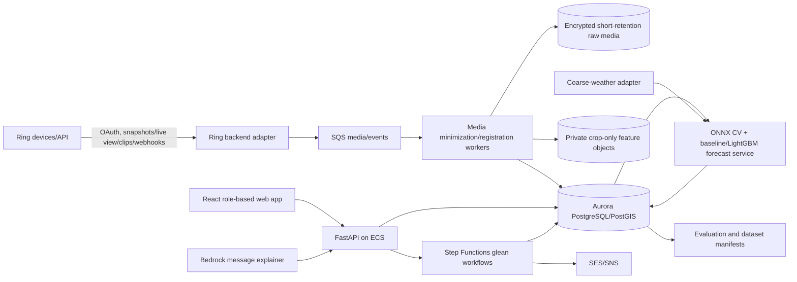

# HarvestGrid — Implementation Specification

**Specification version:** 1.0.0  
**Primary track:** Ring  
**Project status:** ready for implementation; no code is implied  
**Dependencies:** [SHARED_ENGINEERING_STANDARD.md](./SHARED_ENGINEERING_STANDARD.md), [harvest-window.schema.json](./schemas/harvestgrid/harvest-window.schema.json)  
**Validated example:** [harvest-window.example.json](./examples/harvestgrid/harvest-window.example.json)

## 1. Product contract

HarvestGrid uses repeated, privacy-bounded Ring observations of a backyard tree to forecast a harvest window, then supports an existing gleaning organization with owner approval, coordinator-led matching, trained volunteers, recipient capacity, and weighed outcomes.

The first release supports **European plum (`Prunus domestica`)**, one owner-confirmed cultivar per deployment cohort, one geographic partner organization, and fixed outdoor cameras. It is an operations and forecasting aid, not an agronomy or food-safety authority.

### 1.1 Primary users

- **Tree owner:** grants tree/camera permission, controls access, and approves a glean request.
- **Gleaning coordinator:** verifies readiness, safety, training, assignments, and completion.
- **Trained volunteer/event leader:** sees only the minimum assignment information.
- **Recipient coordinator:** states produce capacity and acceptance windows.
- **Model evaluator:** reviews held-out forecasts and dataset manifests; has no operational dispatch authority.

### 1.2 Non-goals

- Diagnosing internal ripeness, sugar content, disease, contamination, or food safety from RGB images.
- A public map of residential fruit trees or exact addresses.
- Autonomously dispatching volunteers or granting property access.
- Face recognition, license-plate reading, worker scoring, or homeowner surveillance.
- Replacing an existing gleaning organization's insurance, training, waivers, food-safety rules, or event leadership.
- Supporting every crop, camera angle, or geography in the first release.

## 2. Requirements

### 2.1 Functional requirements

| ID | Requirement | Priority |
| --- | --- | --- |
| FR-HG-001 | Register an owner, organization, tree, cultivar, coarse location, and explicit operational consents. | P0 |
| FR-HG-002 | Link a supported Ring device through the documented backend OAuth/API flow and discover actual capabilities. | P0 |
| FR-HG-003 | Configure tree ROI, exclusion/privacy masks, camera view version, and owner-approved collection schedule. | P0 |
| FR-HG-004 | Collect supported snapshots/live-view frames/event clips through the real Ring adapter; deduplicate and record provenance. | P0 |
| FR-HG-005 | Register frames, detect camera movement, crop to the approved tree ROI, and reject unsuitable views. | P0 |
| FR-HG-006 | Produce visible-fruit detections, count/area/color features, occlusion and quality metrics with model/data versions. | P0 |
| FR-HG-007 | Generate a versioned probabilistic harvest window and visible-yield estimate using the canonical schema. | P0 |
| FR-HG-008 | Mark forecasts experimental when data/model gates are unmet; always require human readiness confirmation. | P0 |
| FR-HG-009 | Obtain owner approval before a forecast becomes a glean request. | P0 |
| FR-HG-010 | Capture volunteer training/availability/equipment and recipient acceptance/capacity as hard constraints. | P0 |
| FR-HG-011 | Produce deterministic coordinator-reviewed assignments with no protected-trait scoring. | P0 |
| FR-HG-012 | Orchestrate invitations, reminders, cancellations, access instructions, and escalation with durable state. | P0 |
| FR-HG-013 | Reveal exact address/access notes only to assigned eligible volunteers for the minimum necessary period. | P0 |
| FR-HG-014 | Record coordinator completion, actual harvested/accepted weights, rejection/spoilage, and donation receipt data. | P0 |
| FR-HG-015 | Compare forecast to outcome in an evaluation set; no automatic production retraining from one outcome. | P0 |
| FR-HG-016 | Support consent revocation, camera unlink, data export/deletion, and organization offboarding. | P0 |

### 2.2 Integration requirements

| ID | Requirement |
| --- | --- |
| INT-HG-001 | A documented Ring API/SDK/simulator/device integration MUST execute in the main observation path and appear in demo evidence. |
| INT-HG-002 | Ring calls MUST be server-to-server; browser code never calls Ring OAuth/device endpoints directly. |
| INT-HG-003 | Webhooks use official HMAC verification, raw-body handling, five-second acknowledgement, idempotency, and rate-limit behavior described in the companion hackathon review. |
| INT-HG-004 | Ring capability discovery selects snapshot, live-view, or event-clip strategy; unsupported capabilities fail visibly rather than being mocked. |
| INT-HG-005 | Open-Meteo or a configured documented weather adapter supplies coarse-location historical/forecast weather; exact residential coordinates are not sent. |
| INT-HG-006 | Custom CV inference runs in a controlled Python/ONNX service; Bedrock may summarize evidence/messages but cannot generate counts, dates, readiness, or assignments. |
| INT-HG-007 | SES/SNS sends only coordinator/owner-approved notifications through durable workflows. |

### 2.3 Non-functional requirements

| ID | Budget/requirement |
| --- | --- |
| NFR-HG-001 | Valid Ring event acknowledgement within five seconds; processing continues asynchronously. |
| NFR-HG-002 | New media begins feature extraction within 15 minutes; scheduled forecasts complete within five minutes per tree on CPU reference infrastructure. |
| NFR-HG-003 | p95 dashboard read latency below 700 ms for a 1,000-tree organization. |
| NFR-HG-004 | Duplicate Ring/weather/notification events produce no duplicate observations, gleans, or messages. |
| NFR-HG-005 | Raw residential media is inaccessible to public users, volunteers without assignment, model trainers without separate consent, and analytics. |
| NFR-HG-006 | Forecast output always includes model/data version, valid interval, uncertainty, and quality/confidence reasons. |
| NFR-HG-007 | Camera or model outage never auto-cancels a confirmed glean or marks produce unsafe/unripe; it creates a coordinator review state. |

## 3. Domain workflow and state machines

### 3.1 Tree onboarding

1. Organization invites owner; owner authenticates and accepts current privacy/operations terms.
2. Owner links Ring account through backend OAuth. The backend stores only necessary tokens/scopes in Secrets Manager.
3. Owner selects a device; adapter discovers capabilities and tests one real frame/snapshot/clip.
4. Owner draws tree ROI and exclusion masks on that real image and marks public/neighbor areas to suppress.
5. Owner confirms species/cultivar, optional bloom-date estimate, collection schedule, and access constraints.
6. Coordinator approves camera view and operational suitability.
7. Collection begins only after both approvals. A camera-view change invalidates the view version and pauses forecasting.

### 3.2 Forecast to glean

```text
collecting
  -> quality_review (if view/model degraded)
  -> forecast_experimental | owner_review_required
  -> coordinator_review_required
  -> owner_glean_approval
  -> matching
  -> coordinator_assignment_approval
  -> invited
  -> confirmed
  -> in_progress
  -> completion_review
  -> weighed
  -> closed
```

Any pre-completion state can enter `cancelled` with actor/reason. `quality_review` never transitions directly to dispatch. A superseding forecast does not silently change a confirmed event; coordinator must approve material schedule changes.

### 3.3 Forecast status

- `experimental`: model/dataset gate unmet or out-of-distribution; visible only for evaluation and coordinator review.
- `owner_review_required`: technically valid forecast awaiting owner review.
- `coordinator_review_required`: owner wants a glean; trained coordinator must assess readiness/operations.
- `coordinator_confirmed`: human confirms a chosen operational window; still not a food-safety claim.
- `rejected`: reviewer rejects with reason.
- `superseded`: immutable prior forecast replaced for future planning.

### 3.4 Glean assignment states

`draft → proposed → coordinator_approved → invited → confirmed → in_progress → completed → weighed → closed`.

Other transitions: `invited → partial_fill`, `confirmed → cancelled`, any active state → `coordinator_review`. Every transition records actor, expected version, reason, and timestamp.

## 4. Reference architecture



### 4.1 Component decisions

- **Web:** React + Vite role-based SPA; no Ring credentials or direct Ring calls.
- **API/workflows:** Python FastAPI on ECS Fargate; Step Functions Standard for long-lived glean coordination.
- **Database:** Aurora PostgreSQL with PostGIS. Exact coordinates and access notes are isolated in a restricted schema.
- **Media:** S3 raw and crop-only buckets with separate IAM/KMS/lifecycle. Raw media cannot be read by training or volunteer roles.
- **CV/forecast:** Python workers using OpenCV, ONNX Runtime, LightGBM, scikit-learn, and NumPy. CPU inference is sufficient for scheduled stills.
- **Weather:** adapter receives coordinates rounded to 0.1° and stores source timestamps.
- **Notifications:** SES email baseline; SNS SMS only with separate opt-in and documented cost/region behavior.

## 5. Required repository layout

```text
harvestgrid/
  apps/
    web/                         # React owner/coordinator/volunteer/recipient UI
  services/
    api/                         # FastAPI REST and authorization
    ring-adapter/                # OAuth, capability, media, webhook handling
    media-worker/                # Registration, crop/mask, quality
    inference/                   # ONNX detection/feature extraction
    forecasting/                 # Baseline/LightGBM and calibration
    workflow/                    # Step Functions task handlers
  packages/
    domain/                      # Python state machines, matching, receipt logic
    contracts/                   # JSON Schema/OpenAPI/event contracts
    ring-client/                 # Canonical port + official SDK/API adapter
    weather-client/
    vision/                      # Registration, detection, tracking, features
    matching/                    # Pure deterministic constraint/score engine
    model-gateway/
    testkit/
  content/
    cultivars/european-plum-v1.json
    rubrics/coordinator-readiness-v1.json
  datasets/
    manifest.schema.json
    README.md                    # Private data location/consent; no residential media in Git
  models/
    README.md                    # Registry URIs, hashes, evaluations; binaries in artifact store
  infra/
  training/                      # Reproducible training/evaluation jobs
  tests/
  docs/
  evidence/
```

## 6. Data model

The canonical forecast is [harvest-window.schema.json](./schemas/harvestgrid/harvest-window.schema.json).

| Table/entity | Important fields and restrictions |
| --- | --- |
| `organizations` | ID, name, status, safety/notification policy versions |
| `users/memberships` | Cognito subject, organization, roles (`owner`, `coordinator`, `volunteer`, `recipient`, `evaluator`), status |
| `trees` | ID, owner, organization, species/cultivar, coarse geohash, bloom estimate, status; no address in general view |
| `restricted_tree_locations` | tree ID, encrypted exact address/coordinates/access notes, reveal policy; separate DB permissions |
| `ring_connections` | owner, device ID, capabilities, secret reference, token status, revoked_at; no token in DB |
| `camera_views` | tree/device, view version, ROI/mask polygons, reference crop hash, approved by/at, status |
| `media_objects` | ID, tree/view, Ring event/reference, S3 URI, captured/ingested timestamps, provenance, delete-after, processed status |
| `observations` | ID, tree/view, media ID, feature vector, quality/occlusion, detector/model/schema versions, SHA-256 |
| `harvest_windows` | canonical JSON, tree, model/dataset version, status, reviewer, valid times, version |
| `weather_observations` | coarse grid, source, observed/forecast times, payload hash, temperature/precipitation features |
| `volunteers` | user/org, training credentials, equipment, availability, travel coarse location, status; no protected traits |
| `recipients/capacity_windows` | organization, crop restrictions, accepted quantity, pickup/delivery window, status |
| `gleans` | tree, forecast, selected window, state, coordinator, safety checklist version, version |
| `assignments` | glean/volunteer, role, invite/response, exact-location reveal expiry, status |
| `weight_records` | glean, scale/reference, gross/net/accepted/rejected kg, entered by, coordinator verified, evidence hash |
| `donation_receipts` | glean, recipient, accepted weight, date, receipt number, non-sensitive export URI |
| `consents/deletion_jobs` | policy/version/scope/revocation and deletion receipts |

## 7. Ring and media adapter

### 7.1 Canonical internal port

```python
class RingAdapter(Protocol):
    async def begin_oauth(self, owner_id: str, return_url: str) -> AuthorizationRedirect: ...
    async def complete_oauth(self, code: str, state: str) -> ConnectionSummary: ...
    async def list_devices(self, connection_id: str) -> list[RingDevice]: ...
    async def capabilities(self, device_id: str) -> RingCapabilities: ...
    async def capture_observation(self, binding: CameraBinding) -> MediaReceipt: ...
    async def fetch_media(self, receipt: MediaReceipt) -> SecureMediaStream: ...
    async def revoke(self, connection_id: str) -> None: ...
```

The official API/SDK mapping is implemented only after preflight verification. These internal names are not assertions about external Ring method names.

### 7.2 Collection policy

- Default schedule: up to four still observations/day around consistent daylight windows, owner-configurable.
- Prefer documented still/snapshot capability when available. Otherwise use documented live-view frame capture or event clips supported by the selected device.
- Do not run continuous recording for fruit forecasting.
- Webhook processing validates signature before parsing, stores only necessary event metadata, acknowledges within five seconds, and processes asynchronously.
- Token refresh, `Retry-After`, device offline, empty history, and revoked consent are explicit states.
- A simulator adapter is allowed for automated tests and the hackathon-permitted simulator path, with `fixture` provenance. Production impact claims require real-device sequences.

### 7.3 Media minimization

1. Verify tree/view/connection authorization and retention.
2. Decode in a sandbox with pixel/duration/size limits; reject malformed/unsupported media.
3. Apply privacy/exclusion masks before any model call.
4. Register to the approved reference view using static-background ORB features plus ECC/homography refinement.
5. Reject if camera displacement, insufficient overlap, blur, darkness, rain occlusion, or ROI coverage exceeds configured thresholds.
6. Save only approved tree ROI crop for feature processing. Raw original remains in the restricted short-retention bucket only when needed for audit/retry.
7. Extract features, write observation hash, schedule raw deletion, and remove temporary files.

No person, face, vehicle, or plate detectors are enabled.

## 8. Vision and forecast specification

### 8.1 Detector and feature pipeline

Baseline detector: torchvision Faster R-CNN with a single `plum` class, fine-tuned on consented/publicly licensed data and exported to ONNX. The production artifact store holds model binaries; Git holds hashes, model cards, and reproducible training code.

Per observation:

- calibrated RGB/HSV histograms within detections and tree ROI;
- visible fruit count and confidence distribution;
- detection area percentiles and relative area change;
- occlusion estimate from ROI coverage, overlap, blur, and quality flags;
- static-camera registration score;
- observation timestamp and day-of-year;
- optional same-view temporal associations using Hungarian assignment on center distance, area, and appearance. Associations below threshold are not treated as the same fruit.

Daily aggregate features use median/IQR and observation count, not one cherry-picked frame. `features_v1` defines exact column order and missing-value sentinels in `packages/vision/features_v1.py`.

### 8.2 Forecast models

**Seasonal baseline (required first):**

- uses owner cultivar, optional bloom estimate, coarse weather, and organization-reviewed prior intervals;
- produces a wide interval and `experimental` status;
- cannot produce a weight estimate unless visible count and cultivar-weight model are available.

**Quantile LightGBM (enabled only after data gate):**

- three quantile models (0.1, 0.5, 0.9) for days-to-ready-start and days-to-ready-end;
- separate visible-count and cultivar-weight models with explicit uncertainty;
- monotonic/time/order validation prevents start/end inconsistencies; invalid predictions are rejected;
- conformal calibration on a held-out calibration set targets 80% intervals;
- out-of-distribution detection uses feature ranges and site/camera-quality checks; OOD returns baseline/experimental.

Production ML forecast gate: at least 100 tree-season sequences across 20 sites, with held-out site and season splits. Below that gate, the application works with the baseline but MUST label forecasts experimental. Human readiness review remains mandatory at every data scale.

### 8.3 Outcome and evaluation

- Trained coordinator readiness label is the forecast target; actual harvest date is a separate operational outcome.
- Weight records use a calibrated scale or coordinator-entered manual weight with source indicated.
- Accepted weight excludes recipient-rejected/spoiled produce; reasons are coarse controlled codes.
- Forecast errors update evaluation datasets only after coordinator verification. Production training requires a new reviewed dataset manifest and approval.

Metrics: start/end MAE, interval coverage/width, visible-count MAE, weight MAE/MAPE where defined, false-ready coordinator override rate, calibration by site/camera, and baseline comparison.

## 9. Deterministic matching and orchestration

### 9.1 Hard filters

A proposed glean cannot be invited unless:

- owner and coordinator approvals are current;
- at least one assigned trained event leader is available;
- volunteer training/equipment satisfies the checklist;
- availability intersects the selected window;
- recipient accepts crop and estimated quantity or a coordinator-approved no-recipient plan exists;
- access/safety restrictions have no unresolved blocker;
- exact-address reveal policy and insurance/waiver requirements are satisfied by the partner organization.

No model may waive a filter.

### 9.2 Ranking among eligible assignments

```text
score = 0.30 * travel_fit
      + 0.25 * schedule_fit
      + 0.20 * recipient_logistics_fit
      + 0.15 * equipment_fit
      + 0.10 * fairness_rotation
```

Each component is 0..1 with a versioned deterministic definition. `fairness_rotation` favors eligible volunteers with fewer recent assignments and MUST NOT use protected traits, homeowner demographics, or inferred behavior. Ties use a seeded stable ordering with seed = glean ID. Coordinator sees the explanation and makes the final assignment.

### 9.3 Workflow tasks

Step Functions handles owner review, coordinator review, invitations with expiry, reminder schedules, partial fill, cancellation, day-of check-in, completion, weight entry, and receipt generation. Every external notification includes idempotency key `glean/state/recipient/template/version`.

Exact address/access notes are revealed after assignment confirmation and expire two hours after the event or on cancellation. Access is logged without recording the address in logs.

## 10. API contracts

| Method/path | Purpose | Role/rule |
| --- | --- | --- |
| `POST /v1/ring/connections` | Begin owner OAuth | owner |
| `GET /v1/ring/devices` | List authorized devices/capabilities | owner |
| `POST /v1/trees` | Register tree/coarse details | owner + org |
| `PUT /v1/trees/{id}/camera-view` | Create ROI/mask/view version | owner; coordinator approves |
| `POST /v1/camera-views/{id}/approve` | Approve operational view | coordinator |
| `POST /v1/trees/{id}/observations` | Request supported observation | owner/coordinator; rate-limited |
| `GET /v1/trees/{id}/observations` | List features/quality, not raw media | owner/coordinator/evaluator scoped |
| `GET /v1/trees/{id}/forecast` | Current canonical forecast | owner/coordinator |
| `POST /v1/forecasts/{id}/reviews` | Owner/coordinator review | correct role + expected version |
| `POST /v1/trees/{id}/gleans` | Create from approved forecast | owner/coordinator |
| `POST /v1/gleans/{id}/match` | Generate eligible ranking | coordinator |
| `POST /v1/gleans/{id}/assignments` | Approve assignments | coordinator + idempotency |
| `POST /v1/assignments/{id}/response` | Accept/decline | assigned volunteer |
| `GET /v1/assignments/{id}/access` | Short-lived exact access details | eligible assigned volunteer only |
| `POST /v1/gleans/{id}/completion` | Record coordinator completion | event leader/coordinator |
| `POST /v1/gleans/{id}/weights` | Add/verify actual weights | leader/coordinator |
| `GET /v1/gleans/{id}/receipt` | Non-sensitive receipt | authorized org roles |
| `POST /v1/consents/{id}/revoke` | Stop collection/reveal and delete | owner/org admin |
| `DELETE /v1/trees/{id}` | Tree deletion workflow | owner + coordinator safeguard |

## 11. UX specification

### Owner

- Tree card: next collection, view health, forecast interval and confidence, explicit experimental/human-review labels.
- Camera setup: real image ROI/mask editor, consent/schedule, Ring connection health.
- Glean approval: selected window, estimated visible yield, volunteer/recipient process, access controls.
- History: forecasts, approved events, actual outcome, export/delete.

### Coordinator

- Review queue sorted by valid forecast time and operational risk, not model confidence alone.
- Tree evidence: dated crops, quality/occlusion, baseline vs model, source provenance.
- Matching board: hard-filter results, score explanation, volunteer training, recipient capacity, manual override reason.
- Event run sheet: safety checklist, contacts, attendance, completion, actual weight/receipt.

### Volunteer and recipient

- Volunteer sees coarse area before acceptance and exact access only afterward for the allowed window.
- Recipient sees crop, estimated range, timing, and acceptance requirements; never owner details.
- All roles have empty/offline/error states and accessible table/card alternatives.

WCAG 2.2 AA, keyboard workflows, non-color quality/status indicators, text alternatives for charts, and mobile-friendly day-of screens are required.

## 12. Security, privacy, and operations safety

| ID | Requirement |
| --- | --- |
| SEC-HG-001 | Exact address/coordinates/access notes are isolated and revealed only under assignment policy. |
| SEC-HG-002 | Raw Ring media defaults to deletion seven days after feature extraction; crop-only media requires separate owner consent for training. |
| SEC-HG-003 | No public residential map, face/plate recognition, person tracking, or volunteer behavioral surveillance. |
| SEC-HG-004 | Camera consent and organizational operating consent are separately revocable; revocation stops collection and address reveal. |
| SEC-HG-005 | Visual outputs never assert internal ripeness or food safety; coordinator checklist governs operational decisions. |
| SEC-HG-006 | Volunteers are never auto-dispatched; trained leader and coordinator approval are mandatory. |
| SEC-HG-007 | Owner address, raw media, access notes, and recipient information are excluded from logs/model prompts/public receipts. |
| SEC-HG-008 | Dataset exports use crop-only media, consent manifest, coarse/no location, and re-identification review. |

Threat tests include forged Ring webhooks, token replay, malicious media, cross-owner crop access, assignment reveal after cancellation, address leakage in notifications/logs, prompt injection in notes, and deletion during an active glean with lawful operational records separated from unnecessary personal data.

## 13. Test and acceptance matrix

### 13.1 P0 acceptance scenarios

| ID | Scenario and expected result |
| --- | --- |
| AC-HG-001 | Given no owner/coordinator view approval, when collection is requested, then no media is collected. |
| AC-HG-002 | Given a real supported Ring device, when onboarding, then capabilities and one real observation are recorded truthfully. |
| AC-HG-003 | Given an invalid webhook signature, when received, then it is rejected without media processing. |
| AC-HG-004 | Given duplicate Ring events, when processed, then one observation/forecast input results. |
| AC-HG-005 | Given an unsupported device capability, when collecting, then a visible capability error occurs and no fixture substitutes silently. |
| AC-HG-006 | Given moved camera/poor registration, when processing, then view pauses and forecast enters quality review. |
| AC-HG-007 | Given people/vehicles outside tree ROI, when minimizing, then masks/crop prevent their use in features or training exports. |
| AC-HG-008 | Given low-quality/occluded images, when forecasting, then uncertainty/reason codes increase and no confident ready claim appears. |
| AC-HG-009 | Given insufficient training data, when forecasting, then baseline output is experimental and requires review. |
| AC-HG-010 | Given any valid forecast, when serialized, then it passes schema and has internal ripeness/food-safety flags false. |
| AC-HG-011 | Given invalid interval ordering/model output, when validating, then forecast is rejected rather than repaired arbitrarily. |
| AC-HG-012 | Given no owner approval, when matching starts, then no invitations or address reveals occur. |
| AC-HG-013 | Given no trained leader, when matching, then the glean is ineligible regardless of score. |
| AC-HG-014 | Given insufficient recipient capacity, when matching, then hard filter blocks or requires coordinator alternative. |
| AC-HG-015 | Given two identical ranking inputs, when scored twice, then explanations and ordering are identical. |
| AC-HG-016 | Given a material new forecast after confirmation, when received, then existing event remains and coordinator review is required. |
| AC-HG-017 | Given cancellation, when volunteer requests access, then exact details are unavailable and tokens are revoked. |
| AC-HG-018 | Given duplicate invitation/completion events, when processed, then one message/event/receipt results. |
| AC-HG-019 | Given actual weights, when verified, then evaluation uses accepted/rejected amounts correctly and no automatic model promotion occurs. |
| AC-HG-020 | Given owner revocation, when next collection/match occurs, then both stop and scoped deletion begins. |
| AC-HG-021 | Given another organization's tree IDs, when accessed, then authorization denies data and media. |
| AC-HG-022 | Given a real Ring device/simulator, when the demo runs, then actual documented Ring data drives features, forecast review, and glean workflow. |

### 13.2 Vision/forecast evaluation

- At least 2,000 held-out annotated frames for detector evaluation and 100 tree-season sequences before enabling non-experimental ML forecasts.
- Splits are by site and season; adjacent frames from one sequence cannot cross train/test.
- Report detector precision/recall and, separately, downstream count/yield/forecast outcomes.
- Compare against seasonal baseline and owner/coordinator-only workflow.
- Slice by camera angle, lighting, weather, occlusion, cultivar, and site; suppress re-identifying location details.

### 13.3 Operational evaluation

Measure coordinator minutes/event, invite fill rate, cancellation/no-show, false-ready review/rejection, actual accepted weight, recipient rejection/spoilage, address-reveal violations (target zero), and owner/volunteer comprehension. Counterfactual “would have been wasted” is reported as an owner-baseline estimate, not measured fact.

## 14. Infrastructure and deployment

CDK provisions:

- VPC, ECS FastAPI/workers/inference, Aurora PostgreSQL/PostGIS with restricted location schema;
- separate raw/crop/receipt buckets with distinct KMS/IAM/lifecycle policies;
- SQS/DLQs, EventBridge schedules, Step Functions glean/deletion workflows;
- Cognito groups/roles, SES/SNS, Secrets Manager for Ring/weather credentials;
- model artifact bucket/registry, signed model manifests, CloudWatch alarms and budgets.

Training runs in a separate AWS account or explicitly isolated project role with no raw residential media default access. Model promotion requires dataset/model cards, held-out evaluation, security scan, and human approval.

## 15. Implementation slices

### Slice 0 — real Ring walking skeleton

- Auth/API/web shell, Ring OAuth/device discovery, one actual snapshot/live frame/clip, ROI/mask, restricted storage.

**Gate:** AC-HG-001–005 and actual Ring evidence before model work.

### Slice 1 — observations and baseline forecast

- Media registration/quality, detector/features, canonical forecast schema, seasonal baseline, owner/coordinator review.

**Gate:** AC-HG-006–011 and a real dated tree sequence.

### Slice 2 — glean operations

- Volunteer/recipient constraints, deterministic matching, Step Functions, address reveal, completion/weights/receipts.

**Gate:** AC-HG-012–019 and complete coordinator-led test glean.

### Slice 3 — privacy, deletion, and evaluation

- Revocation/offboarding, dataset manifests, held-out evaluation, weather adapter, security/accessibility/performance.

**Gate:** AC-HG-020–022 and operational/privacy test matrix.

### Slice 4 — seasonal pilot and ML gate

- One-crop partner pilot, baseline evaluation, dataset growth, optional quantile model only after data gate, production runbook/demo.

**Gate:** all P0 scenarios, rubric at least 90, no unsupported forecast/impact claim.

## 16. Demo and validation evidence

The under-three-minute demo shows:

1. actual Ring device/simulator and documented observation path;
2. dated fixed-view tree series, ROI/masks, features, and one low-quality example;
3. canonical forecast with uncertainty and experimental/human-review status;
4. owner and coordinator approvals;
5. deterministic eligible matching and approved invitations;
6. completed test glean with actual scale weight, recipient acceptance, receipt, and forecast error;
7. cancellation or revocation demonstrating address/collection protection.

Do not compress time without dates, call visible color “internal ripeness,” or claim all rescued fruit would otherwise have been wasted.

## Optional mini-challenge artifacts

These are optional and MUST NOT weaken privacy or the coordinator-led workflow.

- **AWS Builder:** submit the actual Ring ingestion/media pipeline, scheduled CV/forecast services, PostGIS operations, Step Functions glean/deletion workflows, and reliability/cost evidence.
- **Open Source:** publish a separate `harvest-window-tools` project with the forecast schema, interval/calibration evaluator, deterministic matching reference implementation, and synthetic organization fixtures. A consented crop-only dataset may be included only after a separate privacy/license review.

Do not publish residential footage, exact addresses, access notes, Ring tokens, or re-identifiable owner/volunteer data. Licensing only the main repository is not an Open Source mini-challenge submission.

## 17. Completion rubric and release blockers

| Category | HarvestGrid full-credit evidence |
| --- | --- |
| Functional — 25 | Ring onboarding→observations→forecast/review→approved glean→weighed outcome/receipt |
| Platform — 15 | Real documented Ring runtime in main path, secure webhook/media lifecycle, device/simulator evidence |
| Architecture/reliability — 15 | Versioned features/models, durable glean workflows, idempotency, deterministic matching, recovery |
| Security/privacy — 15 | ROI/mask minimization, restricted location/media, revocation/deletion, no face/plate or public map |
| UX/accessibility — 10 | Role-specific owner/coordinator/volunteer/recipient flows, uncertainty clarity, mobile/day-of accessibility |
| Testing/evaluation — 10 | All 22 P0 scenarios, held-out vision/forecast evaluation, real pilot operations and baseline comparison |
| Docs/operations — 5 | Ring/device setup, coordinator runbook, model/dataset cards, restore/replay/deletion/incident guides |
| Demo/submission — 5 | Real dated Ring-to-weighed-outcome story under three minutes with product feedback |

### Non-negotiable completion gates

- No internal-ripeness, food-safety, or guaranteed-yield claim from RGB imagery.
- No invitation/dispatch without owner, coordinator, trained-leader, safety, and recipient constraints.
- No exact address or raw residential media leaks across roles, logs, prompts, exports, or cancellation boundaries.
- Forecasts remain experimental until the data gate and always require human readiness review.
- Actual Ring integration and a real dated observation sequence are mandatory for completion.
