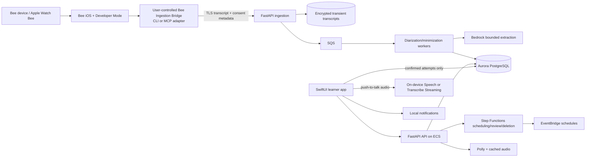

# NextTime — Implementation Specification

**Specification version:** 1.0.0  
**Primary track:** Bee  
**Project status:** ready for implementation; no code is implied  
**Dependencies:** [SHARED_ENGINEERING_STANDARD.md](./SHARED_ENGINEERING_STANDARD.md), [real-world-attempt.schema.json](./schemas/nexttime/real-world-attempt.schema.json)  
**Validated example:** [real-world-attempt.example.json](./examples/nexttime/real-world-attempt.example.json)

## 1. Product contract

NextTime uses authentic, consented Bee-recorded language attempts to deliver a 90-second rehearsal before an explicitly identified recurring situation, then evaluates the next authentic attempt against the same functional rubric.

The first release supports **English-speaking adults learning Dutch** at approximately A2–B1 functional level. It supports three situations: apartment-repair appointment, school-administration appointment, and workplace-shift clarification. It does not diagnose proficiency or optimize for accent imitation.

### 1.1 Primary outcome

The primary product outcome is successful independent completion of the next real-world communication task. Rehearsal completion, pronunciation scores, streaks, and model confidence are secondary diagnostics.

### 1.2 Capture modes

1. **Consented conversation:** the learner attests that every participant consented to recording and processing. Bee transcript data may be processed transiently with both speaker channels to infer task outcome. Other-speaker turns are deleted after minimization and are not retained in the long-term attempt.
2. **Self memo:** after a conversation, the learner records their own account through Bee. No bystander audio/transcript is captured. Outcome confidence is generally lower and requires learner confirmation.

Recording is user-initiated for the supported learning workflow. NextTime MUST NOT create a covert always-on language or emotion profile.

### 1.3 Non-goals

- Thirty language pairs, CEFR certification, or a general AI tutor.
- Live covert coaching during a conversation.
- Medical, legal, immigration, disciplinary, financial, or crisis conversations.
- Accent eradication, emotion/personality inference, or native-speaker identity scoring.
- Using bystander content for training or long-term personalization.
- Claiming causation from a two-attempt demo.

## 2. Requirements

### 2.1 Functional requirements

| ID | Requirement | Priority |
| --- | --- | --- |
| FR-NT-001 | Ingest actual Bee/Apple Watch Bee recording references and transcripts through documented CLI, MCP, or Agent Skill connectivity. | P0 |
| FR-NT-002 | Require capture mode, consent attestation, situation, and retention policy before processing. | P0 |
| FR-NT-003 | Separate learner turns using Bee labels, diarization, learner labeling, or self-only mode; ambiguous turns require review. | P0 |
| FR-NT-004 | Minimize transient transcripts and retain no long-term other-speaker transcript in the canonical attempt. | P0 |
| FR-NT-005 | Propose at most three functional breakdowns with self-evidence excerpts and ASR/model confidence. | P0 |
| FR-NT-006 | Require learner confirmation/correction before a low-confidence or consequential breakdown updates the learner model. | P0 |
| FR-NT-007 | Evaluate the authentic attempt with a deterministic situation rubric; ambiguous outcomes remain unknown. | P0 |
| FR-NT-008 | Let the learner mark the next occurrence or explicitly link a calendar event and rehearsal time. | P0 |
| FR-NT-009 | Generate a schema-valid 90-second rehearsal targeting one confirmed functional breakdown. | P0 |
| FR-NT-010 | Deliver local notification and an iOS audio role-play with push-to-talk learner turns. | P0 |
| FR-NT-011 | Map rehearsal responses to expected communicative functions and offer bounded support; do not update real-world mastery from rehearsal alone. | P0 |
| FR-NT-012 | Link the next authentic attempt to the same recurrence/rubric and compare outcomes. | P0 |
| FR-NT-013 | Show functional progress, evidence, uncertainty, and rehearsal history without gamified streak pressure. | P0 |
| FR-NT-014 | Support correction, exclusion, consent revocation, export, and deletion. | P0 |
| FR-NT-015 | Work without Bedrock by using educator-reviewed deterministic rehearsal templates. | P0 |

### 2.2 Integration requirements

| ID | Requirement |
| --- | --- |
| INT-NT-001 | Bee iOS app and Developer Mode prerequisites MUST be documented and exercised; actual Bee data MUST appear in the main demo. |
| INT-NT-002 | `BeeAdapter` MUST support at least one real documented path: official CLI or MCP. A transcript-upload-only path does not satisfy the track. |
| INT-NT-003 | The rehearsal client is iOS 17+ SwiftUI; Bee/Apple Watch performs authentic capture, while iPhone performs rehearsal playback/interaction. |
| INT-NT-004 | Polly supplies rehearsal counterpart audio; learner speech uses on-device Speech where Dutch support is verified, otherwise explicitly consented Transcribe Streaming. |
| INT-NT-005 | Bedrock performs bounded breakdown/scenario proposals through the shared model gateway; deterministic templates remain authoritative fallbacks. |
| INT-NT-006 | Calendar access is optional and incremental; the core flow works with learner-marked recurrence and local notifications. |

### 2.3 Non-functional requirements

| ID | Budget/requirement |
| --- | --- |
| NFR-NT-001 | A new Bee transcript begins processing within 60 seconds after bridge ingestion under normal connectivity. |
| NFR-NT-002 | Rehearsal audio starts within 1.5 seconds after cached download or 4 seconds on first generation; push-to-talk response begins within 2.5 seconds p95. |
| NFR-NT-003 | No long-term record contains other-speaker raw transcript; automated schema and database scans enforce this. |
| NFR-NT-004 | Transient source transcripts delete within 24 hours of successful minimization or immediately on failure/revocation. |
| NFR-NT-005 | Duplicate Bee recording references create one attempt; rehearsal notifications and outcome updates are idempotent. |
| NFR-NT-006 | Real-world outcome assertions below confidence 0.75 or without required evidence remain `unknown` pending learner review. |

## 3. Domain model and rubrics

The canonical portable attempt is [real-world-attempt.schema.json](./schemas/nexttime/real-world-attempt.schema.json).

### 3.1 Supporting entities

| Entity | Fields and behavior |
| --- | --- |
| `Learner` | `id`, Cognito subject, `target_language=nl`, `support_language=en`, time zone, notification/accessibility settings; no diagnosis |
| `ConsentGrant` | `id`, learner, capture mode, policy version, participants attested, timestamp, revocation; immutable versions |
| `BeeSourceCursor` | adapter, encrypted cursor, last sync, lease expiry; one active sync worker per learner |
| `TransientTranscript` | attempt, encrypted S3 URI, speaker-label status, delete-after, processing lease; excluded from normal APIs |
| `Attempt` | canonical minimized attempt, review status, outcome, source reference, version |
| `SkillState` | learner, skill code, Beta `alpha`/`beta`, last authentic attempt, version |
| `Recurrence` | learner, situation, scheduled event, explicit source, rehearsal time, status |
| `Rehearsal` | recurrence, target breakdown, template/model version, scenario JSON, state, scheduled/completed timestamps |
| `RehearsalTurn` | expected function, counterpart audio URI, learner transcript (24-hour retention), mapped result, confidence |
| `OutcomeComparison` | prior attempt, next attempt, rubric version, criterion deltas, comparison confidence |
| `DeletionJob` | learner/attempt scope, source/backend/cache stages, receipts and errors |

### 3.2 Skill model

Initial skills:

```text
goal_statement
comprehension_repair
time_expression
polite_request
confirmation
closure
independent_completion
```

Each skill has a Beta distribution with initial `alpha=1`, `beta=1`. Only a **confirmed authentic attempt** updates it:

- satisfied: `alpha += 1`;
- not satisfied: `beta += 1`;
- partial evidence: `alpha += 0.5`, `beta += 0.5`;
- unknown: no update.

`mastery = alpha / (alpha + beta)` is displayed with attempt count and uncertainty, not as a CEFR score. Rehearsals update rehearsal history only. A rejected breakdown never updates state.

### 3.3 Functional rubric `rubric_v1`

| Situation | Required criteria | Success rule |
| --- | --- | --- |
| `repair_appointment` | `goal_stated`, `appointment_confirmed` | Both satisfied; `repair_requested` tracked separately when misunderstanding occurred |
| `school_admin_appointment` | `goal_stated`, `appointment_confirmed` | Both satisfied |
| `shift_clarification` | `goal_stated`, `next_step_confirmed` | Both satisfied |

Common optional criteria: `details_understood`, `repair_requested`, `independent_completion`.

- `failed`: evidence shows a required criterion was not satisfied and the interaction ended.
- `partial`: goal was stated but a required confirmation remains unresolved, or explicit human/language-switch assistance completed the task.
- `unknown`: source lacks sufficient evidence, ASR/diarization is uncertain, or the learner disputes extraction.
- The model proposes criterion evidence; deterministic rules compute status. Learner correction is stored as a new version.

### 3.4 Attempt state machine

```text
discovered -> consent_required -> processing -> review_required
processing -> awaiting_learner_review -> confirmed
review_required -> awaiting_learner_review
awaiting_learner_review -> excluded | deletion_pending
confirmed -> deletion_pending (on revocation/request)
deletion_pending -> deleted (tombstone only)
```

Only `confirmed` attempts drive learner state and outcome comparisons. `excluded` attempts are retained only until their deletion policy expires and never appear in progress.

### 3.5 Rehearsal state machine

```text
draft -> scheduled -> ready -> in_progress -> completed
scheduled -> rescheduled | cancelled
ready -> expired | in_progress
in_progress -> abandoned | completed
completed -> linked_to_next_attempt
```

A rehearsal can target exactly one primary breakdown and up to two support phrases. Completing a rehearsal does not imply real-world success.

## 4. Reference architecture



### 4.1 Bee Ingestion Bridge

The bridge is a Python 3.12 user-controlled service for macOS or a trusted private host. It is required because developer CLI/MCP connectivity and credentials MUST NOT be embedded in the public iOS app.

It provides:

```python
class BeeAdapter(Protocol):
    async def health(self) -> AdapterHealth: ...
    async def list_recordings(self, cursor: str | None) -> RecordingPage: ...
    async def get_transcript(self, reference: str) -> BeeTranscript: ...
    async def acknowledge(self, reference: str, cursor: str) -> None: ...
```

- `BeeCliAdapter` executes the official CLI directly with argument arrays, no shell interpolation, a 30-second timeout, bounded output, and redacted logs.
- `BeeMcpAdapter` uses the official documented transport and tool names discovered during preflight; tools are allowlisted read-only.
- Exact external commands/tools and response mappings MUST be verified against installed official documentation. The agent MUST NOT invent them.
- Bridge stores credentials in OS keychain or Secrets Manager on a private host, never in the iOS bundle or Git.
- Transcript upload occurs only after the learner selects capture mode and signs the consent attestation.
- Acknowledgement cursor advances only after durable server ingestion, preventing data loss.

## 5. Required repository layout

```text
nexttime/
  apps/
    ios/                          # SwiftUI app and local notification/audio storage
  services/
    api/                          # FastAPI REST and learner operations
    bee-bridge/                   # User-controlled CLI/MCP ingestion service
    ingestion/                    # Transcript persistence and deduplication
    minimization/                 # Diarization, redaction, deletion
    rehearsal/                    # Scenario, audio, scheduling workers
  packages/
    domain/                       # Python attempt/rubric/skill/state logic
    contracts/                    # JSON Schema/OpenAPI and generated Swift types
    rubrics/                      # Versioned deterministic task rubrics
    bee-adapter/                  # Protocol and CLI/MCP implementations
    model-gateway/
    scenario-templates/           # Educator-reviewed Dutch/English templates
    testkit/
  content/
    situations/
      repair_appointment/
      school_admin_appointment/
      shift_clarification/
    phrases.nl-en.reviewed.json
  infra/
  tests/
  docs/
  evidence/
```

## 6. API contracts

| Method/path | Purpose | Rules |
| --- | --- | --- |
| `POST /v1/attempts/ingest` | Bridge uploads source package | bridge scope + consent + idempotency |
| `GET /v1/attempts` | List learner attempts | minimized fields only |
| `GET /v1/attempts/{id}` | Attempt review detail | owner only |
| `POST /v1/attempts/{id}/review` | Confirm/correct/reject breakdowns and outcome | owner + expected version |
| `POST /v1/attempts/{id}/exclude` | Exclude from learner model | owner; schedules deletion |
| `POST /v1/recurrences` | Mark next occurrence and rehearsal time | owner; explicit timestamp |
| `POST /v1/recurrences/{id}/calendar-link` | Link explicitly selected event | incremental OAuth scope |
| `POST /v1/recurrences/{id}/rehearsal` | Generate from confirmed target | idempotent per recurrence/version |
| `GET /v1/rehearsals/{id}` | Scenario, audio, state | owner |
| `POST /v1/rehearsals/{id}/turns` | Submit one push-to-talk transcript | owner + sequence |
| `POST /v1/rehearsals/{id}/complete` | Complete rehearsal only | owner + final sequence |
| `GET /v1/progress` | Authentic outcomes, skill state, uncertainty | owner |
| `POST /v1/consents/{id}/revoke` | Stop ingestion and start scoped deletion | owner |
| `GET /v1/export` | Export minimized learner data | owner + recent auth |
| `DELETE /v1/account` | Delete account and derived artifacts | owner + recent auth |

The transient transcript endpoint is never exposed to the iOS app or general API roles. Signed audio URLs expire in 15 minutes and are limited to rehearsal counterpart clips.

## 7. Transcript minimization pipeline

1. **Validate source:** schema, Bee reference, consent, capture mode, duration/size, and duplicate check.
2. **Store transient source:** encrypted S3 object with 24-hour maximum lifecycle and a deletion timer; no public URL.
3. **Diarize/label:** use Bee labels if reliable; consented conversations may use AWS diarization; self memo is self-only. Ambiguous speaker segments become `review_required`.
4. **Extract task evidence:** Bedrock receives the minimum required turns and situation rubric. It proposes self-evidence excerpts and criterion candidates.
5. **Redact:** remove names, phone numbers, addresses, account numbers, exact employer/school identifiers, and all other-speaker transcript turns from the persisted attempt. Keep only task labels and self excerpts needed for review.
6. **Validate canonical attempt:** enforce `other_speaker_transcript_retained=false`, allowed fields, time bounds, and evidence ownership.
7. **Learner review:** required for low ASR confidence, ambiguous outcome, self memo, or any proposed breakdown below 0.85 confidence. The learner can confirm high-confidence outcomes later; no automatic rehearsal is sent until required review is complete.
8. **Delete source:** transient transcript and model caches delete immediately after minimization and required review artifacts are secured; failure/revocation triggers immediate deletion.

A self-evidence excerpt may contain incidental personal data. The review UI lets the learner redact it; redacted excerpts are replaced with `[redacted]` without changing outcome logic.

## 8. Rehearsal generation and interaction

### 8.1 Scenario contract

`scenario_generate.v1` input: situation, one confirmed breakdown, skill state, previous scenario IDs, and next-occurrence coarse context. It MUST NOT include raw bystander text.

Output:

```json
{
  "scenario_version": 1,
  "situation": "repair_appointment",
  "target_function": "confirmation",
  "estimated_seconds": 90,
  "counterpart": {
    "persona": "property_scheduler",
    "voice_id": "configured-dutch-voice",
    "speaking_rate": "medium"
  },
  "turns": [
    {
      "turn_id": "t1",
      "counterpart_text_nl": "...",
      "counterpart_text_en": "...",
      "expected_functions": ["goal_stated"],
      "accepted_phrase_ids": ["goal_repair_basic"],
      "repair_if_missing": "goal_statement"
    }
  ],
  "success_criteria": ["goal_stated", "appointment_confirmed"],
  "support_phrases": [{"phrase_id": "confirm_time", "text_nl": "...", "text_en": "..."}],
  "safety_exclusions": ["medical", "legal", "payment"]
}
```

A validator rejects new situations, sensitive content, more than six turns, over 120 estimated seconds, unregistered voices, unreviewed target functions, or unsupported Dutch grammar flagged by the educator-review process. Generated scenarios are cached and do not become training data.

### 8.2 Role-play engine

- The iOS state machine, not the model, controls turns.
- Counterpart audio is Polly output cached by text/voice/rate hash.
- Learner presses and holds to speak; release ends capture.
- On-device Dutch recognition is used only if availability and accuracy pass device tests; otherwise explicit streaming transcription consent is requested.
- A deterministic semantic mapper first matches reviewed phrase IDs and keywords; a bounded model classifier may propose `expected_function` with confidence. Below 0.75, the app asks for a retry or displays phrase support.
- The role-play offers one repair and one easier alternative before ending. It does not shame, interrupt in real time, or assign a native-likeness score.
- A rehearsal can be completed with text/tap choices for speech/accessibility needs; these runs are labeled as non-speaking practice.

### 8.3 Scheduling

- Default rehearsal time is 60 minutes before the learner-marked occurrence.
- Learner explicitly confirms/edits this time. Quiet hours default to 21:00–08:00 local; computed times inside quiet hours require learner selection rather than automatic notification.
- Local notifications work without APNs. APNs is a P1 enhancement only.
- If no rehearsal is ready, notification opens the reviewed template rather than generating in the foreground unexpectedly.

## 9. iOS UX specification

1. **Today:** next real situation, rehearsal readiness, and one primary action.
2. **Bee connection:** Developer Mode/bridge health, last sync, capture-mode instructions, no technical secrets.
3. **Attempt review:** situation, self-only excerpts, outcome rubric, proposed breakdown, confidence and correction/redaction.
4. **Recurrence editor:** next occurrence, source, rehearsal time, notification choice.
5. **Rehearsal:** large push-to-talk control, counterpart captions, progress, support phrase, exit without penalty.
6. **Outcome comparison:** prior and next authentic attempts side by side, criterion evidence, uncertainty.
7. **Progress:** functional wins and skill states with attempt counts; no streaks or leaderboards.
8. **Privacy:** consent history, source/derived retention, excluded situations, export/delete/revoke.

Accessibility: Dynamic Type, VoiceOver labels and rotor actions, captions, haptic/visual recording state, switch-control-compatible rehearsal, no audio-only outcome, and reduced motion. The learner can complete review and rehearsal without speech.

## 10. Security, privacy, and ethics

| ID | Requirement |
| --- | --- |
| SEC-NT-001 | Consent is capture-mode-specific and revocable; self memo is the required alternative when participant consent is unavailable. |
| SEC-NT-002 | Other-speaker transcript exists only transiently in consented mode and is never included in the canonical attempt, analytics, prompts for unrelated tasks, or training. |
| SEC-NT-003 | Bee credentials remain in the trusted bridge; iOS receives only learner-scoped API tokens. |
| SEC-NT-004 | Raw rehearsal audio deletes immediately after transcription; rehearsal transcripts delete after 24 hours unless the learner explicitly saves a self excerpt. |
| SEC-NT-005 | Transient source deletion is alarmed and verified; revoked consent prevents further bridge acknowledgement/ingestion. |
| SEC-NT-006 | No sensitive situation ingestion; classifiers and user controls exclude medical/legal/immigration/disciplinary/financial/crisis content. |
| SEC-NT-007 | No inference of emotion, intelligence, employment status, ethnicity, health, or native identity. |
| SEC-NT-008 | Evaluation reports ASR errors by accent and device; low-confidence recognition never becomes a negative real-world outcome without review. |

Threat tests include malicious Bee transcript text, prompt injection, forged bridge credentials, replayed recording IDs, cross-learner access, transcript fields smuggled into analytics, stale consent, and deletion during processing.

## 11. Observability and evaluation

Safe metrics:

- Bee sync health/latency and duplicate suppression;
- consent mode and minimization success/failure code;
- review/correction rate by rubric field;
- transient deletion age and failures;
- rehearsal readiness, start/completion, notification timing;
- transcription/model fallback and latency;
- authentic criterion outcomes and comparisons;
- skill updates blocked due to unknown/rejected evidence;
- deletion completion.

Logs contain learner/attempt/rehearsal IDs and codes, never raw transcript, self excerpts, event titles, addresses, or counterpart content.

## 12. Test and acceptance matrix

### 12.1 P0 acceptance scenarios

| ID | Scenario and expected result |
| --- | --- |
| AC-NT-001 | Given no consent attestation, when a transcript arrives, then processing is rejected and transient data is deleted. |
| AC-NT-002 | Given self-memo mode, when other-speaker-like turns appear, then they are excluded or sent to review, never persisted as conversation evidence. |
| AC-NT-003 | Given duplicate Bee references, when ingested concurrently, then one attempt results. |
| AC-NT-004 | Given ambiguous diarization, when extraction completes, then review is required and no skill update occurs. |
| AC-NT-005 | Given a minimized attempt, when serialized/scanned, then it passes schema and contains no other-speaker transcript collection. |
| AC-NT-006 | Given a rejected breakdown, when review completes, then learner state and rehearsal targeting do not use it. |
| AC-NT-007 | Given ASR confidence below 0.75, when outcome is proposed, then status remains unknown pending learner review. |
| AC-NT-008 | Given goal stated but no appointment confirmation, when rubric runs, then outcome is partial/failed according to evidence, not success. |
| AC-NT-009 | Given sufficient confirmation evidence, when rubric runs, then deterministic success and criterion explanation result. |
| AC-NT-010 | Given a learner-marked recurrence, when rehearsal is generated, then it targets only the confirmed breakdown and lasts at most 120 seconds. |
| AC-NT-011 | Given Bedrock unavailable, when rehearsal is requested, then the reviewed template delivers the same target function. |
| AC-NT-012 | Given quiet hours, when default time is computed, then learner must choose notification behavior rather than being interrupted automatically. |
| AC-NT-013 | Given duplicate turn/notification events, when processed, then no duplicate rehearsal turn or notification persists. |
| AC-NT-014 | Given ambiguous rehearsal speech, when mapped, then retry/support is offered and no negative authentic outcome is recorded. |
| AC-NT-015 | Given completed rehearsal only, when progress loads, then authentic mastery remains unchanged. |
| AC-NT-016 | Given a linked second authentic attempt, when confirmed, then criterion deltas and skill updates occur once. |
| AC-NT-017 | Given revoked consent, when the next bridge sync/process occurs, then ingestion stops and deletion starts. |
| AC-NT-018 | Given account deletion, when jobs finish, then attempts, transcripts, audio, caches, prompts, and derived states under service control are deleted. |
| AC-NT-019 | Given another learner's IDs, when API access is attempted, then all object access is denied. |
| AC-NT-020 | Given actual Bee hardware/Apple Watch Bee, when the demo runs, then real recorded/processed data flows through documented CLI/MCP into two authentic attempt evaluations. |

### 12.2 Rubric and model evaluation

- At least 300 consented/synthetic transcript fixtures across all situations, outcomes, speaker ambiguity, code-switching, Dutch proficiency levels, and ASR noise.
- Golden datasets are split by learner and conversation; no near-duplicate leakage.
- Report criterion precision/recall, unknown-selectivity, correction rate, and outcome accuracy against blinded human labels.
- Compare scenario relevance and safety against deterministic templates; generated scenarios must not reduce task success or increase educator-flagged errors.
- Report transcription WER and functional mapping errors by accent/device where sample size permits; suppress small-cell identity reporting.

### 12.3 Real-world study

A within-learner baseline compares generic time-matched role-play with NextTime recurrence-linked rehearsal. Primary endpoints: required criterion success, independent repair, and unwanted language switching on the next authentic attempt. Secondary endpoints: confidence, rehearsal adherence, and seven-day retention.

No learning-impact claim is allowed from app analytics alone. The final report states sample size, consent, missing attempts, ASR limitations, and confounders.

## 13. Infrastructure and deployment

CDK provisions:

- VPC, ECS Fargate API/workers, Aurora PostgreSQL, transient S3 with aggressive lifecycle, rehearsal-audio S3/CloudFront;
- SQS/DLQs, EventBridge, Step Functions minimization/scheduling/deletion workflows;
- Cognito user pools, separate bridge credentials, KMS, Secrets Manager;
- Bedrock/Polly/Transcribe least-privilege roles and model-cost alarms;
- CloudWatch dashboards for sync, deletion, transcription, rehearsal, and outcome processing.

The Bee bridge has a separate signed desktop/private-host package and setup guide. Production bridge endpoints use mTLS or short-lived OIDC device credentials; no long-lived bridge secret appears in iOS.

## 14. Implementation slices

### Slice 0 — real Bee walking skeleton

- iOS app/API/auth, bridge protocol, one actual Bee recording through documented CLI/MCP, consent gate, transient ingestion.

**Gate:** actual Bee reference reaches backend once, duplicate-safe, with no personalization yet.

### Slice 1 — minimization and authentic rubric

- Diarization/self memo, redaction, canonical schema, review UI, deterministic rubrics, learner skill state.

**Gate:** AC-NT-001–009, 017 and privacy scans.

### Slice 2 — recurrence and rehearsal

- Recurrence editor, local notifications, deterministic templates, Polly audio, push-to-talk role-play, generated scenario fallback.

**Gate:** AC-NT-010–015 and offline/template behavior.

### Slice 3 — closed real-world loop

- Second-attempt linkage, comparison/progress, export/delete, model evaluation, all security and accessibility paths.

**Gate:** AC-NT-016–020 and two actual Bee attempts.

### Slice 4 — release validation

- Multi-week consented learner study, native Dutch educator review, performance, clean setup, demo and submission package.

**Gate:** all P0 scenarios, rubric at least 90, honest evaluation report.

## 15. Demo and validation evidence

The under-three-minute demo uses consenting actors and two actual Bee captures:

1. Bee/Apple Watch records the first repair-appointment attempt.
2. Real CLI/MCP ingestion and minimization produce the canonical attempt; other-speaker retention is visibly absent.
3. Learner confirms one functional breakdown and next appointment.
4. A 90-second Dutch rehearsal is delivered before the marked recurrence.
5. The second actual Bee attempt demonstrates confirmation/repair and the deterministic outcome comparison.
6. A short failure clip shows low-confidence ASR remaining unknown or consent revocation stopping ingestion.

Editing may compress days, but timestamps and actual Bee provenance must remain truthful. Do not claim that one pair proves learning efficacy.

## Optional mini-challenge artifacts

These are optional and MUST NOT expand the sensitive-data scope.

- **AWS Builder:** submit the deployed minimization/deletion workflows, learner-state/rubric services, Polly/Bedrock rehearsal pipeline, and measured sync/latency/deletion evidence.
- **Open Source:** publish a separate `real-world-attempt-tools` project containing the consent-aware schema, deterministic rubric/reference evaluator, and synthetic or explicitly consented de-identified evaluation fixtures. Include its own license, tests, documentation, and data provenance.

Never publish raw Bee recordings, bystander turns, identifiable learner excerpts, or credentials as open-source fixtures.

## 16. Completion rubric and release blockers

| Category | NextTime full-credit evidence |
| --- | --- |
| Functional — 25 | Two-attempt closed loop, consent/review, recurrence, rehearsal, deterministic outcome and progress |
| Platform — 15 | Actual Bee/Apple Watch Bee data through documented CLI/MCP in the main demo and product runtime |
| Architecture/reliability — 15 | Idempotent ingestion, transient deletion, durable scheduling, offline/template rehearsal, measured latency |
| Security/privacy — 15 | Consent modes, no retained bystander transcript, bridge secret isolation, revocation/export/delete tests |
| UX/accessibility — 10 | Respectful review/rehearsal/progress, Dynamic Type/VoiceOver, non-speaking path, no manipulative streaks |
| Testing/evaluation — 10 | All 20 P0 scenarios, 300+ fixtures, accent/error analysis, authentic outcome study with limitations |
| Docs/operations — 5 | Bee Developer Mode/bridge setup, native-content review, deletion/incident runbooks, full traceability |
| Demo/submission — 5 | Two real Bee attempts and outcome comparison, honestly time-compressed, with product feedback |

### Non-negotiable completion gates

- No authentic outcome or learner-state update occurs without sufficient evidence and required review.
- No long-term other-speaker transcript, covert recording, or sensitive-situation profile remains.
- Rehearsal completion is never presented as real-world mastery.
- Actual Bee integration and two real attempts are required for completion; upload-only and fixture-only demos are incomplete.
- No unsupported learning, fluency, or accent claims are made.
